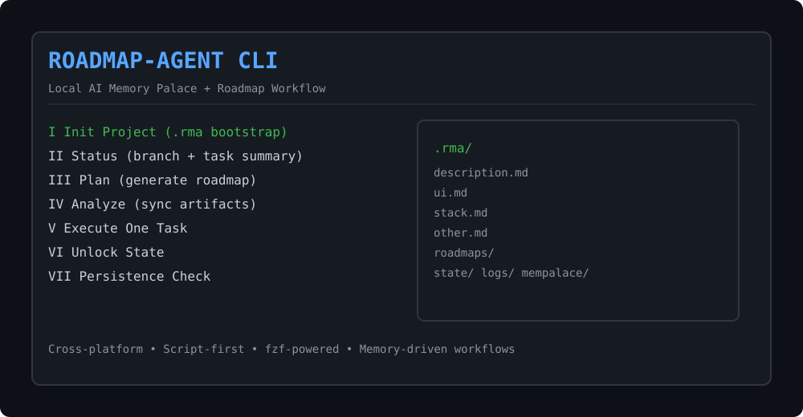

<h1 align="center">🚀 ROADMAP-AGENT</h1>

<p align="center">
  <b>Cross-platform Local AI Memory Palace CLI</b><br/>
  Script-first • Zero fluff • Built for real workflows
</p>

<p align="center">
  
  
  
  
</p>

Cross-platform, script-first Local AI Memory Palace CLI with a built-in Roadmap Agent workflow.

`ROADMAP-AGENT` is designed to run directly from scripts (`.ps1` and `.sh`) with minimal assumptions, while keeping roadmap context in a project-local `.rma/` memory folder.

## UI Placeholder



---

## What It Does

- Provides an interactive CLI menu powered by `fzf`.
- Maintains project memory/context in `.rma/`.
- Supports roadmap lifecycle commands (`init`, `status`, `plan`, `execute-one`, `unlock`).
- Supports analyzer sync command (`analyze`) to keep roadmap artifacts current.
- Supports interactive scaffold command (`analyze-init`) to generate `.rma/*.md` with preview + accept/deny.
- Integrates MemPalace-oriented flows (setup/safe-mine/health/logs/reset).
- Supports persistence/global command installation checks across platforms.

---

## Directory Structure

```text
RoadmapAgent/
  roadmap-agent                 # Universal launcher (Linux/macOS + Git Bash style usage)
  roadmap-agent.cmd             # CMD launcher -> PowerShell runtime
  rma                           # Alias launcher
  rma.cmd                       # Alias CMD launcher
  rma.ps1                       # Alias PowerShell launcher
  rma.sh                        # Alias shell launcher

  scripts/
    unix/
      roadmap-agent.sh          # Unix runtime
      setup-local-models-mempalace.sh
    windows/
      roadmap-agent.ps1         # Windows runtime
      setup-local-models-mempalace.ps1
      install-persistence.ps1   # Windows persistence installer

  docker/
    entrypoint.sh               # Docker runtime entrypoint
  Dockerfile

  DOCS/
    GETTING-STARTED.md
    MENU-REFERENCE.md
    ROADMAP-WORKFLOW.md
    ARCHITECTURE.md
    TROUBLESHOOTING.md
    MANUAL.md
    man/
      roadmap-agent.1

  CHANGELOG.md
```

---

## Runtime Model

### 1) Launchers

- `roadmap-agent`, `roadmap-agent.cmd`, and aliases route execution to platform-specific runtimes.
- On Windows, launchers call `scripts/windows/roadmap-agent.ps1`.
- On Linux/macOS, launchers call `scripts/unix/roadmap-agent.sh`.
- Current Windows runtime is a Defender-safe bridge: it forwards core CLI execution to the Unix runtime through `bash` (WSL/Git Bash), and keeps persistence install handling local on Windows.

### 2) Core metadata and state (`.rma/`)

`ROADMAP-AGENT` stores project context and generated planning state in `.rma/` at the project root.

Required context files:

- `.rma/description.md`
- `.rma/ui.md`
- `.rma/stack.md`
- `.rma/other.md`

If any required files are missing, the CLI warns and suggests running `roadmap-agent init`.

Generated files/directories include:

- `.rma/*.example.md`
- `.rma/roadmaps/plan.md`
- `.rma/roadmaps/tasks.md`
- `.rma/roadmaps/run.md`
- `.rma/state/`
- `.rma/logs/`
- `.rma/mempalace/`

### 3) Interactive menu

- Uses Roman numerals (`I`, `II`, `III`, ...).
- Uses `fzf` for all interactive selections.
- Includes roadmap and persistence-check entries in the same UI.

---

## Requirements

## Windows

- PowerShell 7+ recommended (`pwsh`), Windows PowerShell also supported through launcher fallback.
- `bash` required for full interactive/menu runtime on Windows bridge mode (WSL bash or Git Bash).
- `git` recommended for project/branch/remote detection.
- `python` optional (for health checks).
- `fzf` is auto-installed locally if missing.

## Linux/macOS

- `bash`
- `git` recommended
- `python` optional
- `fzf` (auto-install supported in runtime when absent)

## Optional Tools

- `mempalace` CLI (if available, runtime uses it; otherwise it falls back to safe placeholders where possible).

---

## Quick Start

```bash
# from project root
./roadmap-agent init
./roadmap-agent
```

Windows PowerShell:

```powershell
.\rma.ps1 init
.\rma.ps1
```

---

## Commands

- `init` - bootstrap `.rma/` and template files.
- `status` - show project/branch and task execution summary.
- `plan` - generate a dry-run roadmap plan file.
- `analyze` - analyze codebase + markdown docs and sync canonical task/run files.
- `analyze-init` - analyze current folder/subfolders and propose generated `.rma` markdown files with preview + accept/deny for each file.
  - `analyze-init --dry-run` generates proposals only (no writes).
  - `analyze-init --yes` auto-accepts and writes all proposed `.rma/*.md` files.
- `execute-one` - execute one selected pending task.
- `unlock` - remove locked state.
- `persistence` / `persistance` - check/install persistence mode.
- `persistence-check` - check if persistence/global command wiring exists.
- `help`, `-h`, `--help` - command help.
- default (no command): open interactive menu.

These options are accessible from all main launchers (`roadmap-agent`, `rma`, `rma.sh`, `rma.ps1`, `roadmap-agent.cmd`, `rma.cmd`) and pass through with the same flags.

### Command-Line Argument Notes

- General form: `roadmap-agent <command> [options]`
- Optional env override: `RMA_DISABLE_FZF=1` forces fallback text menus/selectors.
- Optional env override: `RMA_OLLAMA_MODEL=<model>` selects local Ollama model for project-aware `.rma` generation (default: `llama3.1:latest`).
- Optional env override: `RMA_REQUIRE_OLLAMA=1` requires local Ollama/model availability for generation.
- Analyzer scaffolding:
  - `roadmap-agent analyze-init` -> interactive per-file preview + accept/deny
  - `roadmap-agent analyze-init --dry-run` -> generate/preview proposals only
  - `roadmap-agent analyze-init --yes` -> auto-accept all generated `.rma/*.md`
  - `roadmap-agent analyze-init --require-ollama` -> fail fast if Ollama/model is missing
- Windows wrappers pass arguments through unchanged:
  - `.\rma.ps1 analyze-init --dry-run`
  - `rma.cmd analyze-init --yes`

### FZF Fallback Behavior

- ROADMAP-AGENT first tries to use `fzf` for menus and interactive choices.
- If `fzf` is missing, it attempts auto-install.
- If auto-install fails, ROADMAP-AGENT now falls back to a built-in text menu/selector system.
- You can force-test this path with `RMA_DISABLE_FZF=1`.
- In fallback mode:
  - menu navigation still works from terminal prompts
  - `analyze-init` still previews each generated `.md` file before accept/deny

### Local LLM Generation (Ollama)

- `analyze-init` now analyzes project files in the current directory/subfolders and generates `.rma` proposals using a local LLM via Ollama.
- The prompt context is built from repository markdown, key config files, file inventory, and extracted task cues.
- If Ollama is unavailable, ROADMAP-AGENT falls back to heuristic generation based on repository evidence.
- Default model is `llama3.1:latest`.
- You can configure runtime behavior via `.env` (copy from `.env.example`):
  - `RMA_OLLAMA_MODEL=llama3.1:latest`
  - `RMA_REQUIRE_OLLAMA=1`
  - `RMA_DISABLE_FZF=0`

### Global Install Dependency Safety

- Persistence installers now sync the **full app repository tree** into the install location (not partial script copies).
- Unix global launcher runs installed app code from `/usr/local/lib/roadmap-agent/scripts/unix/roadmap-agent.sh`.
- Windows global launcher runs installed app code from `%ProgramFiles%\Roadmap-Agent\scripts\windows\roadmap-agent.ps1`.
- This prevents broken dependencies when global commands or symlink-like wrappers are used.
- If you installed persistence before this change, run persistence install again to refresh wrappers and synced app files.
- `persistence-check` now reports installed vs current version and prompts upgrade when installed persistence is older.

---

## Deployment Guide

This section covers how to run ROADMAP-AGENT in development, team environments, and persistent/global mode.

## A) Project-local deployment (recommended default)

Use repository scripts directly, keeping everything scoped to the current project.

### Windows

```powershell
git clone <repo-url>
cd RoadmapAgent
.\rma.ps1 init
.\rma.ps1
```

If `bash` is unavailable, install WSL or Git Bash to enable the full menu workflow.

### Linux/macOS

```bash
git clone <repo-url>
cd RoadmapAgent
chmod +x roadmap-agent rma scripts/unix/roadmap-agent.sh
./roadmap-agent init
./roadmap-agent
```

Best when you want isolated behavior per repository.

## B) Global/persistence deployment

Global mode is intended to make `roadmap-agent` available from anywhere.

### Windows

- Run terminal as Administrator.
- Use `.\rma.ps1 persistence-check`.
- If missing, accept installer prompt to run `scripts/windows/install-persistence.ps1`.
- Installer targets Program Files and machine PATH.

### Linux/macOS

- Use `roadmap-agent persistence` (or `persistence-check` and accept install).
- Runtime installs command wrappers under `/usr/local/bin`.
- Runtime can update detected shell RC file with deduplicated managed PATH block.

## C) Container deployment (Docker)

Build:

```bash
docker build -t roadmap-agent .
```

Run:

```bash
docker run --rm -it -v "$PWD:/workspace" roadmap-agent
```

Notes:

- Mount your project into `/workspace`.
- Container entrypoint routes into the Unix runtime.

---

## Environment Variables

The runtime works without custom environment variables, but supports useful overrides and inherited shell configuration.

| Variable | Used By | Purpose | Example |
|---|---|---|---|
| `ROADMAP_AGENT_PROJECT_ROOT` | Unix runtime | Forces project root detection instead of deriving from script location | `export ROADMAP_AGENT_PROJECT_ROOT="$PWD"` |
| `PATH` | All runtimes | Used to find `git`, `python`, `mempalace`, `fzf`, and installed launchers | `PATH=/usr/local/bin:$PATH` |
| `FZF_DEFAULT_OPTS` | fzf | Optional global styling/behavior overrides for fzf menus | `export FZF_DEFAULT_OPTS='--height 85%'` |
| `ProgramFiles` | Windows runtime | Resolves persistence install path (`Roadmap-Agent\bin`) | Inherited from Windows |
| `SHELL` | Unix runtime | Used to detect preferred RC file in persistence mode | `/bin/bash`, `/bin/zsh` |

### ENV Guidance

- `ROADMAP_AGENT_PROJECT_ROOT` is the main project override variable and is useful in custom wrappers.
- Avoid overriding `PATH` in a way that hides system binaries (`git`, `python`, `pwsh`).
- If you customize `FZF_DEFAULT_OPTS`, keep compatible options with the runtime’s own fzf flags.

---

## `.rma/` Best Practices

- Keep `.rma/description.md` current with product intent and hard constraints.
- Use `.rma/ui.md` for CLI UX rules and formatting expectations.
- Track stack/runtime versions in `.rma/stack.md`.
- Record operational constraints, limits, and team conventions in `.rma/other.md`.
- Re-run `plan` after major scope changes so next tasks match current context.
- Use `analyze-init` when onboarding or after major refactors to regenerate `.rma` context files with explicit review gates.

---

## Troubleshooting

## Menu does not open

- Ensure `fzf` is installed/available in PATH.
- Re-run command from project root.
- Try non-interactive command (`status`) to confirm runtime pathing.

## Missing `.rma` warnings

- Run `roadmap-agent init`.
- Confirm `.rma/description.md`, `ui.md`, `stack.md`, `other.md` exist.

## Windows script blocked by AV

- Keep runtime scripts small/modular and avoid unnecessary obfuscation patterns.
- Run from trusted folder and verify file integrity from source control.
- If your environment blocks script content, test with `status` first after each change.
- This repository currently uses a Windows PowerShell bridge strategy to reduce AV false positives by keeping heavy runtime logic in shell scripts.

## Persistence not detected

- Run `persistence-check`.
- Verify launcher directories are present in machine/user PATH.
- Open a new terminal after installer modifies PATH.

---

## Security and Operational Notes

- ROADMAP-AGENT is script-first and executes local commands; review scripts before broad rollout.
- Persistence mode modifies PATH and may require elevated privileges.
- Validate generated plans before executing tasks in production repositories.
- Keep backups/version control for `.rma/` when used as long-lived project memory.

---

## Documentation Index

- `DOCS/GETTING-STARTED.md`
- `DOCS/MENU-REFERENCE.md`
- `DOCS/ROADMAP-WORKFLOW.md`
- `DOCS/ARCHITECTURE.md`
- `DOCS/TROUBLESHOOTING.md`
- `DOCS/MANUAL.md`
- `DOCS/man/roadmap-agent.1`
- `CHANGELOG.md`
# ROADMAP-AGENT

Cross-platform, script-first Local AI Memory Palace CLI with an integrated Roadmap Agent.

## Directory Layout (OS Organized)

```text
RoadmapAgent/
  roadmap-agent
  roadmap-agent.cmd
  rma
  rma.cmd
  rma.ps1
  rma.sh
  Dockerfile
  CHANGELOG.md
  DOCS/
    GETTING-STARTED.md
    MENU-REFERENCE.md
    ROADMAP-WORKFLOW.md
    ARCHITECTURE.md
    TROUBLESHOOTING.md
    MANUAL.md
    man/
      roadmap-agent.1
  docker/
    entrypoint.sh
  scripts/
    windows/
      roadmap-agent.ps1
      setup-local-models-mempalace.ps1
      install-persistence.ps1
    unix/
      roadmap-agent.sh
      setup-local-models-mempalace.sh
```

## Entry Points

- `roadmap-agent` - universal launcher that routes to OS-specific runtime.
- `roadmap-agent.cmd` - Windows CMD launcher for PowerShell runtime.
- `rma`, `rma.cmd`, `rma.ps1`, `rma.sh` - alias launchers.

## Runtime Scripts (How They Work)

- `scripts/windows/roadmap-agent.ps1`
  - Main Windows runtime.
  - Handles interactive hub + AI submenu, `.rma` validation, roadmap plan/status/execute/unlock, and MemPalace actions.
  - Performs local `fzf` auto-install when missing.
- `scripts/unix/roadmap-agent.sh`
  - Main Linux/macOS runtime.
  - Mirrors Windows behavior for menu flow, roadmap actions, and MemPalace actions.
  - Contains Unix persistence flow for global install and shell rc dedupe.

## Support Scripts

- `scripts/windows/setup-local-models-mempalace.ps1`
  - Best-effort local model setup on Windows.
- `scripts/unix/setup-local-models-mempalace.sh`
  - Best-effort local model setup on Linux/macOS.
- `scripts/windows/install-persistence.ps1`
  - Admin installer for Windows global command access and machine PATH update.
- `docker/entrypoint.sh`
  - Starts Unix runtime inside container from `/workspace`.

## Commands

- `roadmap-agent init`
- `roadmap-agent status`
- `roadmap-agent plan`
- `roadmap-agent analyze`
- `roadmap-agent analyze-init`
- `roadmap-agent analyze-init --dry-run`
- `roadmap-agent analyze-init --yes`
- `roadmap-agent execute-one`
- `roadmap-agent unlock`
- `roadmap-agent persistence` / `roadmap-agent persistance`
- `roadmap-agent persistence-check`
- `roadmap-agent --help` / `roadmap-agent help`
- `roadmap-agent man`
- `roadmap-agent` (interactive mode)

Interactive options are shown as Roman numerals (`I`, `II`, `III`, ...) for cleaner menu display.

## `.rma/` Folder

Required context:

- `.rma/description.md`
- `.rma/ui.md`
- `.rma/stack.md`
- `.rma/other.md`

Generated state:

- `.rma/*.example.md`
- `.rma/roadmaps/plan.md`
- `.rma/roadmaps/tasks.md`
- `.rma/roadmaps/run.md`
- `.rma/state/*`
- `.rma/logs/*`

## Docker

- Build: `docker build -t roadmap-agent .`
- Run: `docker run --rm -it -v "$PWD:/workspace" roadmap-agent`

## Documentation Index

- `DOCS/GETTING-STARTED.md`
- `DOCS/MENU-REFERENCE.md`
- `DOCS/ROADMAP-WORKFLOW.md`
- `DOCS/ARCHITECTURE.md`
- `DOCS/TROUBLESHOOTING.md`
- `DOCS/MANUAL.md`
- `DOCS/man/roadmap-agent.1`
- `CHANGELOG.md`
