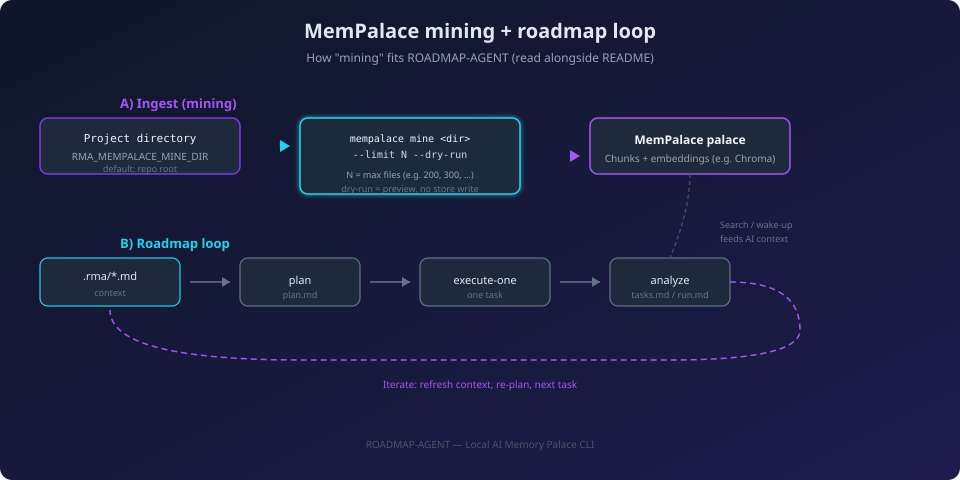

<p align="center">
  
</p>

<h1 align="center">ROADMAP-AGENT</h1>

<p align="center">
  <b>Cross-platform Local AI Memory Palace CLI</b><br/>
  Terminal-first roadmap CLI: keep project memory in <code>.rma/</code>, run <code>plan</code> → <code>execute-one</code> → <code>analyze</code>, plug in local LLMs (Ollama) and MemPalace—no hosted dashboard.
</p>

<p align="center">
  
  
  
  
  
</p>

### Documentation at a glance

| Doc | What you get |
|-----|----------------|
| **[`docs/QUICKSTART.md`](docs/QUICKSTART.md)** | **Fast lane by OS** — clone, optional Python/MemPalace setup, `.env`, `init`, `doctor`, and global `rma` on Windows (`launchers/setup-rma.ps1`, PATH refresh). |
| **[`docs/TESTING.md`](docs/TESTING.md)** | **Tests** — run `pytest` layout checks; copy-paste prompt to extend coverage (doctor JSON, web API, installers). |
| **[`docs/MANUAL.md`](docs/MANUAL.md)** | **Operator manual** — every command, interactive hub, writing `.rma` Markdown (`description`, `ui`, `stack`, `other`), `analyze` / `analyze-init`, LLM providers, persistence, safety. |
| **[`docs/ROADMAP-WORKFLOW.md`](docs/ROADMAP-WORKFLOW.md)** | **Process guide** — plan → review → `execute-one` loop, keeping context fresh, low-risk habits. |
| **[`img/roadmap-mining-and-loop.svg`](img/roadmap-mining-and-loop.svg)** | **Visual** — MemPalace mining (directory, limit, dry-run) vs roadmap loop; same concepts as the section below. |
| **[`docs/examples/rma-context-samples/`](docs/examples/rma-context-samples/)** | **Sample `.rma` context** — three folders (`weather-app`, `list-sharing`, `devtools-cli`) with `description.md`, `ui.md`, `stack.md`, `other.md`; copy into `.rma/` after `init`. See README there for **MCP** integration notes. |
| **[`docs/examples/END-TO-END-LIST-SHARING-APP.md`](docs/examples/END-TO-END-LIST-SHARING-APP.md)** | **End-to-end walkthrough** — import, MemPalace + `.rma` driving **detailed** roadmaps, **agent prompts** for open decisions, **`execute-one`** loop toward a **real shipped app** (mock transcripts). |
| **[`docs/examples/MOCK-WORKFLOW-SESSION.md`](docs/examples/MOCK-WORKFLOW-SESSION.md)** | **Illustrative session** — fictional terminal output from persistence install through `init`, `doctor`, menus, `plan` / `analyze` / `execute-one`, and sample log lines. |
| **[`CHANGELOG.md`](CHANGELOG.md)** | **Release history** — what changed per version; pair with the root **`VERSION`** file and git tags (`v1.0.0`, …). |
| **[`docs/RELEASING.md`](docs/RELEASING.md)** | **Shipping a release** — tags, GitHub releases, source archives, Docker image; why there is no required compiled “binary”. |
| **[`web/README.md`](web/README.md)** | **Optional web UI** — FastAPI + React: **Guided** (grouped keys + hints) and **Advanced** (filter + bulk `KEY=value`) `.env` editor, footer doc links, `doctor --json`, model probes; dev, single-port, Docker; build-time **`VITE_DOCS_BASE`** for doc URLs. |

**ROADMAP-AGENT** keeps project memory in **`.rma/`**, drives plans and one-step execution from the terminal, and plugs into **local LLMs** (Ollama by default) when you want project-aware scaffolding—not a hosted dashboard, not another SaaS login.

---

## What It Does

- **Menus that do not get in the way** — `fzf` when it is there; honest text prompts when it is not.
- **Project memory that stays in the repo** — Markdown under `.rma/`, not a black-box database.
- **Roadmap lifecycle** — `init`, `status`, `plan`, `execute-one`, `unlock` for small, reviewable steps.
- **Repo-aware analysis** — `analyze` keeps `tasks.md` / `run.md` honest; `analyze-init` drafts context files with preview (and LLM help when configured).
- **MemPalace + LLM workflows** — **`plan`** writes **`plan.md`** using your **LLM** (Ollama by default) and the `.rma` context bundle; optional **`mempalace wake-up`** text enriches the prompt when **`.rma/mempalace`** exists. Safe **mine** uses the real **`mempalace`** CLI (after `setup-local-models-mempalace`). Set **`RMA_ALLOW_PLAN_FALLBACK=1`** for a static template if the LLM is unavailable (dev-only).
- **Run from anywhere (if you want)** — persistence installers for Windows, Linux, and macOS so `rma` can live on your PATH.

---

## MemPalace mining and the roadmap loop

### What “mining” is

**Mining** (in MemPalace) means **ingesting files from a directory on disk**—source, docs, notes—**into your local “palace”**: text is split into chunks, embedded, and stored (typically via **ChromaDB**) so the tool can **search**, **retrieve context**, and support downstream AI workflows. It is **not** crypto mining; it is **indexing your repo (or a subtree) into structured memory** you control offline.

In ROADMAP-AGENT, the AI submenu runs the real upstream CLI in **safe (dry-run) mode** so you can preview work without committing ingest until you are ready to run MemPalace directly for a full ingest.

### Arguments you pass (and what they mean)

| Piece | Role |
|--------|------|
| **Directory** (`mempalace mine <dir>`) | **Required.** The tree MemPalace scans. In ROADMAP-AGENT this defaults to your **project root** (`ROOT_DIR`). Override with **`RMA_MEMPALACE_MINE_DIR`** (relative paths are resolved under the project root). |
| **`--limit N`** | **Cap on how many files** are processed in this run (e.g. **200** on menu **II**, or **300 / 800 / 1500** on menu **III**). Smaller limits are faster and narrower; larger limits cover more of the tree in one go. **`0`** in MemPalace usually means “no cap” (upstream default); the menu always passes a positive number. |
| **`--dry-run`** | **Preview only**—shows what **would** be filed into the palace **without** writing stored vectors for that run. The interactive menu uses dry-run so “safe mine” stays non-destructive; run **`mempalace mine …`** yourself without `--dry-run` when you want a full ingest. |

Under the hood the shell invokes something equivalent to:

```bash
mempalace mine "<resolved_directory>" --limit <N> --dry-run
```

(Exact flags follow the installed **`mempalace`** package; see `mempalace mine --help`.)

### How the two tracks fit together

1. **Mining track (A)** — Refreshes **what the palace knows** about your files (preview via dry-run from the menu).
2. **Roadmap track (B)** — **`init` → context in `.rma/` → `plan` → `execute-one` → `analyze`** to keep **`plan.md` / `tasks.md` / `run.md`** aligned with reality. You repeat (B) as the project moves; you run (A) when you want embeddings and search to reflect the latest tree.

The palace and the roadmap files are complementary: the roadmap is **human-readable planning state** under `.rma/roadmaps/`; the palace is **retrieval-oriented memory** for tools that support MemPalace.

### Intended outcome: build the app, not just the docs

ROADMAP-AGENT is designed for **iterated implementation**: **`.rma/*.md`** is the **product contract** MemPalace-aware **`plan`** and your **AI agent** should **read**; **mining** keeps retrieval aligned with the repo; **`execute-one`** drives **concrete work** that lands in **your codebase**. Logs and `plan.md` are for **steering and audit**.

- **Detailed roadmaps:** Invest in context files and refresh **`plan`** so **`plan.md` / `tasks.md`** can be **very detailed**—phases, dependencies, risks, acceptance-style notes—not a thin outline.
- **Interpretation + prompting:** Where **`description.md` / `ui.md` / `stack.md` / `other.md`** are silent or ambiguous, the **agent in your loop** should **ask you** (auth model, visibility rules, compliance) and you **record** answers back into `.rma/` before the next **`plan`**. The CLI can help: **`plan`** (interactive TTY) prompts for bullets in **`.rma/open-questions.md`** and for **`Open:`** lines in the four context files, then appends answers to **`other.md`** before the LLM generates **`plan.md`**—use **`plan --no-interactive`** or **`RMA_PLAN_INTERACTIVE=0`** in CI.
- **Shipping:** Each cycle should move you toward **runnable software**; see **[`docs/examples/END-TO-END-LIST-SHARING-APP.md`](docs/examples/END-TO-END-LIST-SHARING-APP.md)** for that narrative end-to-end.

### Visual overview



**Step-by-step product example:** [`docs/examples/END-TO-END-LIST-SHARING-APP.md`](docs/examples/END-TO-END-LIST-SHARING-APP.md) (importing the tool into an app repo, commands, mock output). **Sample context Markdown:** [`docs/examples/rma-context-samples/`](docs/examples/rma-context-samples/).

---

## Directory Structure

```text
RoadmapAgent/
  VERSION                     # Semver release (read by CLI banner; keep in sync with CHANGELOG / git tags)
  RUN.sh / RUN.ps1 / RUN.cmd  # Only files at repo root besides docs/config: bootstrap venv + .env, then CLI

  img/                        # README / marketing images (banner, diagram, placeholders)
  launchers/                  # roadmap-agent, rma, *.cmd, setup-rma.*, refresh-rma-path.ps1 (thin wrappers)

  scripts/
    unix/
      roadmap-agent.sh          # Unix runtime
      setup-local-models-mempalace.sh
    windows/
      roadmap-agent.ps1         # Windows runtime
      setup-local-models-mempalace.ps1
      setup-rma.ps1             # Windows persistence wrapper (canonical; launchers/setup-rma.ps1 forwards here)
      install-persistence.ps1   # Windows persistence installer
      refresh-rma-path.ps1      # PATH refresh helper (used by installer/setup)

  docker/
    entrypoint.sh               # Docker runtime entrypoint
    Dockerfile.web              # Optional FastAPI image for the companion web UI
  Dockerfile
  docker-compose.yml            # Optional: rma-web service (localhost:8765)

  web/
    README.md                   # Web UI setup (dev, production-style, Docker)
    run-backend.ps1 / run-backend.sh
    backend/                    # FastAPI app
    frontend/                   # Vite + React SPA

  requirements-web.txt          # Python deps for web/backend (pip -r from repo root)

  docs/
    QUICKSTART.md            # Per-OS quick start (Windows, Linux, macOS, Docker)
    GETTING-STARTED.md
    MENU-REFERENCE.md
    ROADMAP-WORKFLOW.md
    ARCHITECTURE.md
    TROUBLESHOOTING.md
    MANUAL.md                # Detailed operator manual (usage, .rma editing, commands)
    man/
      roadmap-agent.1
    examples/
      END-TO-END-LIST-SHARING-APP.md  # Full walkthrough: import, setup, plan/mine loop (mock)
      MOCK-WORKFLOW-SESSION.md   # Illustrative install → init → doctor → hub → roadmap logs
      rma-context-samples/       # Example description/ui/stack/other per app type (+ MCP notes)
        README.md
        weather-app/   list-sharing/   devtools-cli/
  CHANGELOG.md
```

---

## Runtime Model

### 1) Launchers

- **User-facing CLI entrypoints** live under **`launchers/`** (`roadmap-agent`, `rma`, `*.cmd`, `*.ps1`, `rma.sh`). The repo root keeps only **`RUN.*`** for bootstrap.
- On Windows, launchers call `scripts/windows/roadmap-agent.ps1`.
- On Linux/macOS, launchers call `scripts/unix/roadmap-agent.sh`.
- Current Windows runtime is a Defender-safe bridge: it forwards core CLI execution to the Unix runtime through `bash` (WSL/Git Bash), and keeps persistence install handling local on Windows.

### 2) Core metadata and state (`.rma/`)

`ROADMAP-AGENT` stores project context and generated planning state in `.rma/` at the project root.

Required context files:

- `.rma/description.md`
- `.rma/ui.md`
- `.rma/stack.md`
- `.rma/other.md`

If any required files are missing, the CLI warns and suggests running `roadmap-agent init`.

Generated files/directories include:

- `.rma/*.example.md`
- `.rma/roadmaps/plan.md`
- `.rma/roadmaps/tasks.md`
- `.rma/roadmaps/run.md`
- `.rma/state/`
- `.rma/logs/`
- `.rma/mempalace/`

### 3) Interactive menu

- Uses Roman numerals (`I`, `II`, `III`, ...).
- Uses `fzf` for all interactive selections.
- Includes roadmap and persistence-check entries in the same UI.

### 4) Optional companion web UI

A **local** FastAPI + React app under [`web/`](web/) can edit the same whitelisted keys as `load_rma_env_file()` in `.env`, run **`rma doctor --json`**, read **`rma tools --json`**, probe Ollama / OpenAI-compatible endpoints, and stream **`ollama pull`**. The backend invokes **`scripts/windows/roadmap-agent.ps1`** or **`scripts/unix/roadmap-agent.sh`** under **`RMA_WEB_APP_ROOT`** (the toolkit checkout), with **`ROADMAP_AGENT_PROJECT_ROOT`** set to the app directory you pick in the UI — same bridge behavior as the CLI, not a separate SaaS.

**SPA behavior**

- **Guided** — keys grouped by topic with short section blurbs and **per-field hints** (provider-specific blocks for Ollama, OpenAI-compatible, Claude).
- **Advanced** — search/filter across every manifest env key; **bulk `KEY=value`** textarea to paste many assignments at once (**load from form**, **apply to form**, **save**). Bulk updates only keys you list; other lines in `.env` stay as on disk.
- **Footer** — opens **MANUAL**, **QUICKSTART**, **web README**, **TROUBLESHOOTING**, **ARCHITECTURE**, **MENU-REFERENCE**, and **`.env.example`** on GitHub (upstream `main` by default). For a fork or custom docs host, set **`VITE_DOCS_BASE`** when building the frontend (see [`web/README.md`](web/README.md)).

**Fast path**

1. **From the hub (menu):** open **`roadmap-agent`** / **`rma`** with no args → **VII** starts the API (creates **`.rma/venv`** if missing, **`pip install -r requirements-web.txt`**, then **uvicorn** on **:8765**); **VIII** runs **`npm install`** and **Vite** on **:5173**. Use two terminals if you want both.
2. **CLI:** **`roadmap-agent web-api`** (alias **`web-backend`**) and **`roadmap-agent web-frontend`** — same behavior as VII / VIII.
3. **Scripts:** `web/run-backend.ps1` (Windows) or `web/run-backend.sh` (Unix) — same API port; they install **`requirements-web.txt`** with the current **`python`** on `PATH` (hub/CLI prefer the **project venv** under **`RMA_PYTHON_VENV_DIR`**).
4. **UI (dev) without hub:** `cd web/frontend && npm install && npm run dev` — open **http://127.0.0.1:5173**, set **Project root** to your repo.
5. **Optional:** set **`RMA_WEB_ADMIN_TOKEN`** in the shell environment before starting the API so mutating routes require **`X-RMA-Web-Token`**.

**Other modes:** build the SPA (`npm run build` in `web/frontend`) and serve it from the same port as the API; or use **`docker compose up --build`** (see [`web/README.md`](web/README.md) for pre-building `dist/` and Windows vs Compose notes).

Full reference: **[`web/README.md`](web/README.md)**, **[`docs/MANUAL.md`](docs/MANUAL.md)** (*Companion web UI*), **`docker-compose.yml`**, **`docker/Dockerfile.web`**.

---

## Requirements

## Windows

- PowerShell 7+ recommended (`pwsh`), Windows PowerShell also supported through launcher fallback.
- `bash` required for full interactive/menu runtime on Windows bridge mode (WSL bash or Git Bash).
- `git` recommended for project/branch/remote detection.
- `python` optional (for health checks).
- `fzf` is auto-installed locally if missing.

## Linux/macOS

- `bash`
- `git` recommended
- `python` optional
- `fzf` (auto-install supported in runtime when absent)

## Optional Tools

- **`mempalace` CLI** and Python packages **`mempalace`** + **`chromadb`** in the project venv — required for **mine** (and for **`mempalace wake-up`** when generating **`plan`**). **`plan`** also needs a working **LLM** (e.g. Ollama). Run the setup script under `scripts/` to install MemPalace. See **`RMA_REQUIRE_MEMPALACE`**, **`RMA_MEMPALACE_BIN`**, and **`RMA_ALLOW_PLAN_FALLBACK`** in `.env.example`.
- **Companion web UI** — Python **`requirements-web.txt`** for the API; **Node.js 18+** and **`npm`** only if you run the Vite dev server or build `web/frontend/dist`. See **[`web/README.md`](web/README.md)**.

---

## Quick Start

```bash
# from clone root (launchers/ holds CLI shims; root has only RUN.*)
./launchers/roadmap-agent init
./launchers/roadmap-agent
```

Windows PowerShell:

```powershell
.\launchers\rma.ps1 init
.\launchers\rma.ps1
```

**More detail:** **[`docs/QUICKSTART.md`](docs/QUICKSTART.md)** (by OS), **[`web/README.md`](web/README.md)** (optional web UI), **[`docs/MANUAL.md`](docs/MANUAL.md)** (full reference), **[`docs/ROADMAP-WORKFLOW.md`](docs/ROADMAP-WORKFLOW.md)** (how to run the roadmap loop), **[`img/roadmap-mining-and-loop.svg`](img/roadmap-mining-and-loop.svg)** (mining vs roadmap diagram), **[`docs/examples/rma-context-samples/`](docs/examples/rma-context-samples/)** (sample `.rma` Markdown), **[`docs/examples/END-TO-END-LIST-SHARING-APP.md`](docs/examples/END-TO-END-LIST-SHARING-APP.md)** (full product example), **[`docs/examples/MOCK-WORKFLOW-SESSION.md`](docs/examples/MOCK-WORKFLOW-SESSION.md)** (sample transcript), **[`CHANGELOG.md`](CHANGELOG.md)** (releases).

---

## Full setup workflow

1. **Clone** this repository and open a terminal at the repo root (or use your project’s root when using ROADMAP-AGENT against another codebase).
2. **Python + MemPalace (required for `mine`; recommended for `plan` wake-up context)** — creates `.rma/venv` (or `RMA_PYTHON_VENV_DIR`) and installs **`mempalace`** + **`chromadb`** plus health-check dependencies. Configure an **LLM** for **`plan`** (Ollama is typical):
   - Windows: `.\scripts\windows\setup-local-models-mempalace.ps1`
   - Linux/macOS: `./scripts/unix/setup-local-models-mempalace.sh`
3. **Environment variables** — copy `.env.example` to `.env` at the **project root** you work in (the app or repo under analysis). Edit `RMA_*` values and any API keys. The runtime reads `.env` from the detected project root when present.
4. **Diagnostics** — `.\launchers\rma.ps1 doctor` (Windows) or `./launchers/roadmap-agent doctor` (Unix) to verify `git`, `bash`, Python venv, LLM providers, and persistence sync.
5. **Roadmap memory** — `init` once, then use the interactive menu or individual commands as needed.

### Global `rma` / `roadmap-agent` on PATH (Windows persistence)

- From the cloned **Roadmap-Agent** repo, run **`.\launchers\setup-rma.ps1`** (optional: `-Scope User` for per-user install without elevation, or `-Scope Machine` as Administrator for all users).
- Under the hood this mirrors the full app tree into `%LOCALAPPDATA%\Roadmap-Agent` (user scope) or `%ProgramFiles%\Roadmap-Agent` (machine scope), adds `...\Roadmap-Agent\bin` to PATH, and writes `roadmap-agent.cmd` / `rma.cmd` launchers.
- **Same PowerShell window after install**: `launchers/setup-rma.ps1` and `install-persistence.ps1` run `scripts/windows/refresh-rma-path.ps1` so the **current session** picks up the updated PATH. You can run `rma --help` immediately without opening a new terminal.
- If PATH still looks stale (e.g. you changed PATH elsewhere), run from the repo:

```powershell
.\refresh-rma-path.ps1
```

That script rebuilds `$env:Path` from the Machine + User registry values (the same merge a new process would get).

- **Check only / upgrade prompt**: `.\launchers\setup-rma.ps1 -CheckOnly -Scope Auto` (compares version, sync, and PATH; can prompt to reinstall).

### Global install (Linux / macOS)

- Use `roadmap-agent persistence` or `roadmap-agent persistence-check` and follow prompts. Open a **new** shell after RC changes, or `source` your profile if you prefer not to restart the terminal.

---

## Commands

- `init` - bootstrap `.rma/` and template files; when the toolkit checkout differs from the project root, also copies the CLI into **`.roadmap-agent/`** and adds project-local **`rma` / `rma.ps1` / `rma.cmd`** (see **`docs/QUICKSTART.md`**). Flags: **`-y`**, **`--embed`**, **`--no-embed`**.
- `status` - show project/branch and task execution summary.
- `doctor` - run diagnostics for environment, providers, and persistence sync state.
- `plan` - generate a dry-run roadmap plan file.
- `analyze` - analyze codebase + markdown docs and sync canonical task/run files.
- `analyze-init` - analyze current folder/subfolders and propose generated `.rma` markdown files with preview + accept/deny for each file.
  - `analyze-init --dry-run` generates proposals only (no writes).
  - `analyze-init --yes` auto-accepts and writes all proposed `.rma/*.md` files.
- `execute-one` - execute one selected pending task.
- `unlock` - remove locked state.
- `persistence` / `persistance` - check/install persistence mode.
- `persistence-check` - check if persistence/global command wiring exists.
- `help`, `-h`, `--help` - command help.
- default (no command): open interactive menu.

These options are accessible from **`launchers/`** (`roadmap-agent`, `rma`, `rma.sh`, `rma.ps1`, `roadmap-agent.cmd`, `rma.cmd`) and, after persistence install, from the same names on your PATH.

### Command-Line Argument Notes

- General form: `roadmap-agent <command> [options]`
- Optional env override: `RMA_DISABLE_FZF=1` forces fallback text menus/selectors.
- Optional env override: `RMA_LLM_PROVIDER=ollama|openllama|claude` selects LLM backend.
- Optional env override: `RMA_OLLAMA_MODEL=<model>` selects local Ollama model for project-aware `.rma` generation (default: `llama3.1:latest`).
- Optional env override: `RMA_OLLAMA_HOST=<url>` sets Ollama API host (default: `http://127.0.0.1:11434`).
- Optional env override: `RMA_OPENAI_BASE_URL=<url>`, `RMA_OPENAI_MODEL=<model>`, `RMA_OPENAI_API_KEY=<key>` for OpenAI-compatible local hosting (openllama).
- Optional env override: `RMA_CLAUDE_MODEL=<model>` with `ANTHROPIC_API_KEY` for Claude integration.
- Optional env override: `RMA_REQUIRE_OLLAMA=1` requires local Ollama/model availability for generation.
- Analyzer scaffolding:
  - `roadmap-agent analyze-init` -> interactive per-file preview + accept/deny
  - `roadmap-agent analyze-init --dry-run` -> generate/preview proposals only
  - `roadmap-agent analyze-init --yes` -> auto-accept all generated `.rma/*.md`
  - `roadmap-agent analyze-init --require-ollama` -> fail fast if Ollama/model is missing
- Windows wrappers pass arguments through unchanged:
  - `.\launchers\rma.ps1 analyze-init --dry-run`
  - `rma.cmd analyze-init --yes`

### FZF Fallback Behavior

- ROADMAP-AGENT first tries to use `fzf` for menus and interactive choices.
- If `fzf` is missing, it attempts auto-install.
- If auto-install fails, ROADMAP-AGENT now falls back to a built-in text menu/selector system.
- You can force-test this path with `RMA_DISABLE_FZF=1`.
- In fallback mode:
  - menu navigation still works from terminal prompts
  - `analyze-init` still previews each generated `.md` file before accept/deny

### Runtime Warnings Panel

- In FZF UI mode, menus now show a runtime warnings panel in a preview window on the **right side (30% width)**.
- The panel includes checks such as:
  - missing required `.rma/*.md` files
  - missing `.env` (informational)
  - missing API tokens (informational)
  - missing Ollama/model
  - fallback menu mode and Git remote status
- In non-FZF fallback mode, the same warnings are printed inline above menu selection prompts.

### Local LLM Generation (Ollama)

- `analyze-init` now analyzes project files in the current directory/subfolders and generates `.rma` proposals using configurable LLM providers:
  - `ollama` (default)
  - `openllama` via OpenAI-compatible local API
  - `claude` via Anthropic API
- The prompt context is built from repository markdown, key config files, file inventory, and extracted task cues.
- If provider requirements are unavailable, ROADMAP-AGENT falls back to heuristic generation unless `--require-ollama`/`RMA_REQUIRE_OLLAMA=1` is set.
- Default model is `llama3.1:latest`.
- If the `ollama` binary is not on PATH (common in some WSL setups), ROADMAP-AGENT also checks Ollama over HTTP using `RMA_OLLAMA_HOST`.
- You can configure runtime behavior via `.env` (copy from `.env.example`):
  - `RMA_LLM_PROVIDER=ollama`
  - `RMA_OLLAMA_HOST=http://127.0.0.1:11434`
  - `RMA_OLLAMA_MODEL=llama3.1:latest`
  - `RMA_OPENAI_BASE_URL=http://127.0.0.1:11434/v1`
  - `RMA_OPENAI_MODEL=openllama`
  - `RMA_OPENAI_API_KEY=local-no-key`
  - `RMA_CLAUDE_MODEL=claude-3-5-sonnet-latest`
  - `ANTHROPIC_API_KEY=...` (real value only in `.env`, never committed)
  - `RMA_REQUIRE_OLLAMA=1`
  - `RMA_DISABLE_FZF=0`

### Global Install Dependency Safety

- Persistence installers now sync the **full app repository tree** into the install location (not partial script copies).
- Unix global launcher runs installed app code from `/usr/local/lib/roadmap-agent/scripts/unix/roadmap-agent.sh`.
- Windows global launcher runs installed app code from `%ProgramFiles%\Roadmap-Agent\scripts\windows\roadmap-agent.ps1`.
- This prevents broken dependencies when global commands or symlink-like wrappers are used.
- If you installed persistence before this change, run persistence install again to refresh wrappers and synced app files.
- `persistence-check` now reports installed vs current version and prompts upgrade when installed persistence is older.

---

## Deployment Guide

This section covers how to run ROADMAP-AGENT in development, team environments, and persistent/global mode.

## A) Project-local deployment (recommended default)

Use repository scripts directly, keeping everything scoped to the current project.

### Windows

```powershell
git clone https://github.com/DTRHnet/Roadmap-Agent.git
cd RoadmapAgent
.\launchers\rma.ps1 init
.\launchers\rma.ps1
```

If `bash` is unavailable, install WSL or Git Bash to enable the full menu workflow.

### Linux/macOS

```bash
git clone https://github.com/DTRHnet/Roadmap-Agent.git
cd RoadmapAgent
chmod +x launchers/roadmap-agent launchers/rma scripts/unix/roadmap-agent.sh
./launchers/roadmap-agent init
./launchers/roadmap-agent
```

Best when you want isolated behavior per repository.

## B) Global/persistence deployment

Global mode is intended to make `roadmap-agent` / `rma` available from any directory.

### Windows

- **Recommended entrypoint**: `.\launchers\setup-rma.ps1` from the cloned repo (see [Full setup workflow](#full-setup-workflow)).
- **Scopes**: `-Scope User` installs under `%LOCALAPPDATA%\Roadmap-Agent` and updates **User** PATH (no Administrator). `-Scope Machine` requires Administrator and installs under `%ProgramFiles%\Roadmap-Agent` and **Machine** PATH.
- **Menu / CLI**: `.\launchers\rma.ps1 persistence-check` may prompt to run the installer; you can also invoke `.\scripts\windows\install-persistence.ps1` directly with `-Scope` and `-CheckOnly` as needed.
- **PATH in the current session**: After a successful install, the installer refreshes PATH via `scripts/windows/refresh-rma-path.ps1`. Run `.\refresh-rma-path.ps1` manually if `rma` is still not resolved.
- **Check / upgrade**: `.\launchers\setup-rma.ps1 -CheckOnly -Scope Auto` reports version, whether installed files match the repo, and whether an upgrade is advisable.

### Linux/macOS

- Use `roadmap-agent persistence` (or `persistence-check` and accept install).
- Runtime installs command wrappers under `/usr/local/bin`.
- Runtime can update the detected shell RC file with a deduplicated managed PATH block. Open a **new** terminal after install so PATH and profile changes apply.

## C) Container deployment (Docker)

Build:

```bash
docker build -t roadmap-agent .
```

Run:

```bash
docker run --rm -it -v "$PWD:/workspace" roadmap-agent
```

Notes:

- Mount your project into `/workspace`.
- Container entrypoint routes into the Unix runtime.

---

## Environment Variables

The runtime works without custom environment variables, but supports useful overrides and inherited shell configuration.

| Variable | Used By | Purpose | Example |
|---|---|---|---|
| `ROADMAP_AGENT_PROJECT_ROOT` | Unix runtime | Forces project root detection instead of deriving from script location | `export ROADMAP_AGENT_PROJECT_ROOT="$PWD"` |
| `RMA_LLM_PROVIDER` | analyze-init | Selects LLM backend (`ollama`, `openllama`, `claude`) | `RMA_LLM_PROVIDER=ollama` |
| `RMA_OLLAMA_HOST` | ollama provider | Ollama API host URL | `RMA_OLLAMA_HOST=http://127.0.0.1:11434` |
| `RMA_OLLAMA_MODEL` | ollama provider | Model used for local generation | `RMA_OLLAMA_MODEL=llama3.1:latest` |
| `RMA_OPENAI_BASE_URL` | openllama provider | OpenAI-compatible local endpoint URL | `RMA_OPENAI_BASE_URL=http://127.0.0.1:11434/v1` |
| `RMA_OPENAI_MODEL` | openllama provider | OpenAI-compatible model name | `RMA_OPENAI_MODEL=openllama` |
| `RMA_OPENAI_API_KEY` | openllama provider | OpenAI-compatible API key/token | `RMA_OPENAI_API_KEY=local-no-key` |
| `RMA_CLAUDE_MODEL` | claude provider | Claude model name | `RMA_CLAUDE_MODEL=claude-3-5-sonnet-latest` |
| `ANTHROPIC_API_KEY` | claude provider | Claude API key | `ANTHROPIC_API_KEY=...` |
| `RMA_REQUIRE_OLLAMA` | analyze-init | Fail fast if Ollama/model unavailable | `RMA_REQUIRE_OLLAMA=1` |
| `RMA_DISABLE_FZF` | menu system | Force fallback text menus/selectors | `RMA_DISABLE_FZF=1` |
| `RMA_PYTHON_VENV_DIR` | setup-local-models | Virtualenv path used by local setup scripts | `RMA_PYTHON_VENV_DIR=.rma/venv` |
| `RMA_REQUIRE_MEMPALACE` | doctor, warnings | `1` = treat missing MemPalace CLI or Python imports as errors in diagnostics | `RMA_REQUIRE_MEMPALACE=1` |
| `RMA_MEMPALACE_BIN` | mine, wake-up (plan prompt) | Optional absolute path to `mempalace` if not on `PATH` | `RMA_MEMPALACE_BIN=/path/to/mempalace` |
| `RMA_MEMPALACE_MINE_DIR` | mine (menu II, III) | Directory passed to `mempalace mine <dir>`; relative paths resolve under project root (default: project root) | `RMA_MEMPALACE_MINE_DIR=.` |
| `RMA_ALLOW_PLAN_FALLBACK` | plan | `1` = write a generic template to `plan.md` if **LLM** plan generation fails (dev-only) | `RMA_ALLOW_PLAN_FALLBACK=0` |
| `RMA_PLAN_INTERACTIVE` | plan | `1` = on an interactive TTY, prompt for open questions from `.rma/open-questions.md` and `Open:` lines before the LLM runs; `0` for CI | `RMA_PLAN_INTERACTIVE=1` |
| `RMA_PLAN_INTERACTIVE_MAX` | plan | Max questions per `plan` run | `15` |
| `PATH` | All runtimes | Used to find `git`, `python`, `mempalace`, `fzf`, and installed launchers | `PATH=/usr/local/bin:$PATH` |
| `FZF_DEFAULT_OPTS` | fzf | Optional global styling/behavior overrides for fzf menus | `export FZF_DEFAULT_OPTS='--height 85%'` |
| `ProgramFiles` | Windows runtime | Resolves persistence install path (`Roadmap-Agent\bin`) | Inherited from Windows |
| `SHELL` | Unix runtime | Used to detect preferred RC file in persistence mode | `/bin/bash`, `/bin/zsh` |

### ENV Guidance

- **Project `.env`**: Copy `.env.example` to `.env` at the **project root** (the repository you are working in). Variables are read by the bash runtime when `.env` exists; use Unix-style `KEY=value` lines. Do not commit `.env` (it is gitignored).
- **Shell exports (Unix)**: For a one-off session, `export RMA_OLLAMA_MODEL=llama3.1:latest` in `bash`/`zsh`. For persistence across logins, add the same to `~/.profile` or your shell RC file, or keep using `.env` per project.
- **Windows**: You can set user-wide variables via **System Properties → Environment Variables**, or `setx RMA_OLLAMA_MODEL "llama3.1:latest"` in `cmd` (requires new console). Prefer a project-local `.env` so settings travel with the repo and stay out of global policy.
- **Secrets**: Put API keys in `.env` or your OS secret store; never commit real keys. `ANTHROPIC_API_KEY`, `RMA_OPENAI_API_KEY`, and `OPENAI_API_KEY` follow the same rule.
- `ROADMAP_AGENT_PROJECT_ROOT` forces project root detection instead of deriving from the script location (useful in CI or wrappers).
- Avoid narrowing `PATH` so much that `git`, `python`, `bash`, or `pwsh` disappear from view.
- If you customize `FZF_DEFAULT_OPTS`, keep options compatible with the runtime’s own `fzf` flags.
- Setup scripts create and activate a project virtual environment (default `.rma/venv`) for installs; runtime commands prefer that venv when `RMA_PYTHON_VENV_DIR` points to an existing env.

---

## `.rma/` Best Practices

- Keep `.rma/description.md` current with product intent and hard constraints.
- Use `.rma/ui.md` for CLI UX rules and formatting expectations.
- Track stack/runtime versions in `.rma/stack.md`.
- Record operational constraints, limits, and team conventions in `.rma/other.md`.
- Re-run `plan` after major scope changes so next tasks match current context.
- Use `analyze-init` when onboarding or after major refactors to regenerate `.rma` context files with explicit review gates.

---

## Troubleshooting

## Menu does not open

- Ensure `fzf` is installed/available in PATH.
- Re-run command from project root.
- Try non-interactive command (`status`) to confirm runtime pathing.

## Missing `.rma` warnings

- Run `roadmap-agent init`.
- Confirm `.rma/description.md`, `ui.md`, `stack.md`, `other.md` exist.

## Windows script blocked by AV

- Keep runtime scripts small/modular and avoid unnecessary obfuscation patterns.
- Run from trusted folder and verify file integrity from source control.
- If your environment blocks script content, test with `status` first after each change.
- This repository currently uses a Windows PowerShell bridge strategy to reduce AV false positives by keeping heavy runtime logic in shell scripts.

## Persistence not detected

- Run `persistence-check` (or `.\launchers\setup-rma.ps1 -CheckOnly -Scope Auto` on Windows).
- Verify the install `bin` directory is on User or Machine PATH (`%LOCALAPPDATA%\Roadmap-Agent\bin` for typical user installs).
- On Windows, run `.\refresh-rma-path.ps1` in the current PowerShell session, or open a **new** terminal after install.
- If `rma` still fails, reinstall from the repo with `.\launchers\setup-rma.ps1 -Scope User` and confirm `Test-Path "$env:LOCALAPPDATA\Roadmap-Agent\scripts\windows\roadmap-agent.ps1"` is true.

---

## Security and Operational Notes

- ROADMAP-AGENT is script-first and executes local commands; review scripts before broad rollout.
- Persistence mode modifies PATH and may require elevated privileges.
- Validate generated plans before executing tasks in production repositories.
- Keep backups/version control for `.rma/` when used as long-lived project memory.

---

## Versioning

- **Canonical release number** lives in the root **`VERSION`** file (for example `1.0.0`). The Unix runtime prints it in the banner as `v1.0.0` when present.
- **`CHANGELOG.md`** follows [Keep a Changelog](https://keepachangelog.com/) with dated sections per release.
- **Git tags** use the `v` prefix (for example `v1.0.0`) so `git describe` and the “last release” line in the CLI stay meaningful. After pulling a release, `git checkout v1.0.0` checks out that tag.

This project is **script-first** (bash + PowerShell). There is no official single-file executable; “shipping” usually means a **tagged source tree**, **zip/tarball** on GitHub Releases, optional **Docker image**, and/or the **Windows persistence** mirror under `%LOCALAPPDATA%\Roadmap-Agent`. Step-by-step: **[`docs/RELEASING.md`](docs/RELEASING.md)**.

---

## Documentation Index

**Onboarding and workflow**

- [`docs/QUICKSTART.md`](docs/QUICKSTART.md) — fastest path by OS (Windows, Linux, macOS, Docker)
- [`docs/TESTING.md`](docs/TESTING.md) — repository tests and how to grow the suite
- [`docs/GETTING-STARTED.md`](docs/GETTING-STARTED.md) — short first-run checklist
- [`docs/ROADMAP-WORKFLOW.md`](docs/ROADMAP-WORKFLOW.md) — effective plan → execute-one operating model
- [`img/roadmap-mining-and-loop.svg`](img/roadmap-mining-and-loop.svg) — diagram: MemPalace mining (directory, limit, dry-run) vs roadmap loop
- [`docs/examples/rma-context-samples/`](docs/examples/rma-context-samples/) — example `description.md` / `ui.md` / `stack.md` / `other.md` for three app types; MCP integration notes
- [`docs/examples/END-TO-END-LIST-SHARING-APP.md`](docs/examples/END-TO-END-LIST-SHARING-APP.md) — end-to-end example (list-sharing app: import tool, commands, mock output, expectations)
- [`docs/examples/MOCK-WORKFLOW-SESSION.md`](docs/examples/MOCK-WORKFLOW-SESSION.md) — fictional terminal log from install through hub, roadmap commands, and mock `.rma/logs` lines

**Reference**

- [`web/README.md`](web/README.md) — optional local web UI (FastAPI + React): install, `RMA_WEB_*`, Docker
- [`docs/MANUAL.md`](docs/MANUAL.md) — full operator manual (commands, `.rma` files, env, persistence, web UI summary)
- [`docs/MENU-REFERENCE.md`](docs/MENU-REFERENCE.md) — hub / submenu labels and actions
- [`docs/ARCHITECTURE.md`](docs/ARCHITECTURE.md) — how the runtime pieces fit together
- [`docs/TROUBLESHOOTING.md`](docs/TROUBLESHOOTING.md) — common failures and fixes
- [`docs/man/roadmap-agent.1`](docs/man/roadmap-agent.1) — Unix man page source

**Releases**

- [`CHANGELOG.md`](CHANGELOG.md) — version-by-version notes (see also **Versioning** above)
- [`docs/RELEASING.md`](docs/RELEASING.md) — tagging, GitHub Release assets, Docker build
