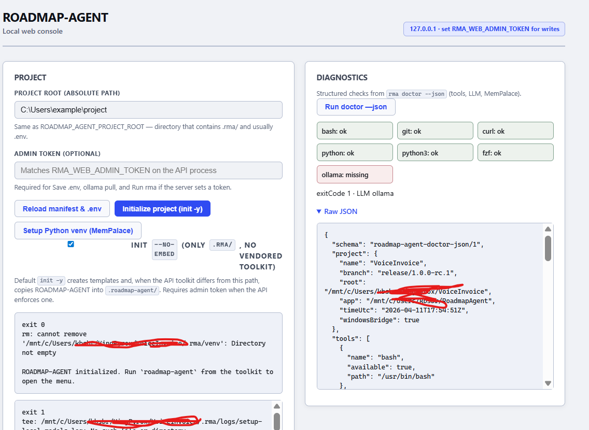
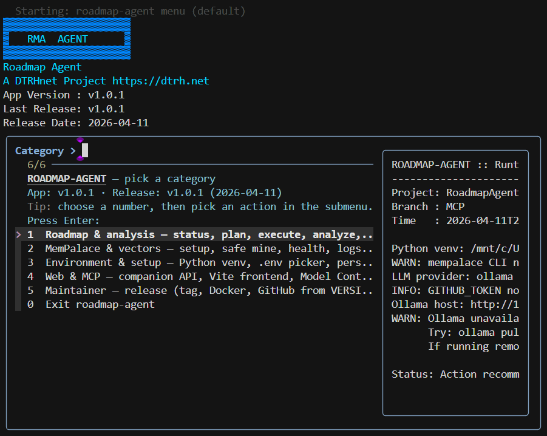
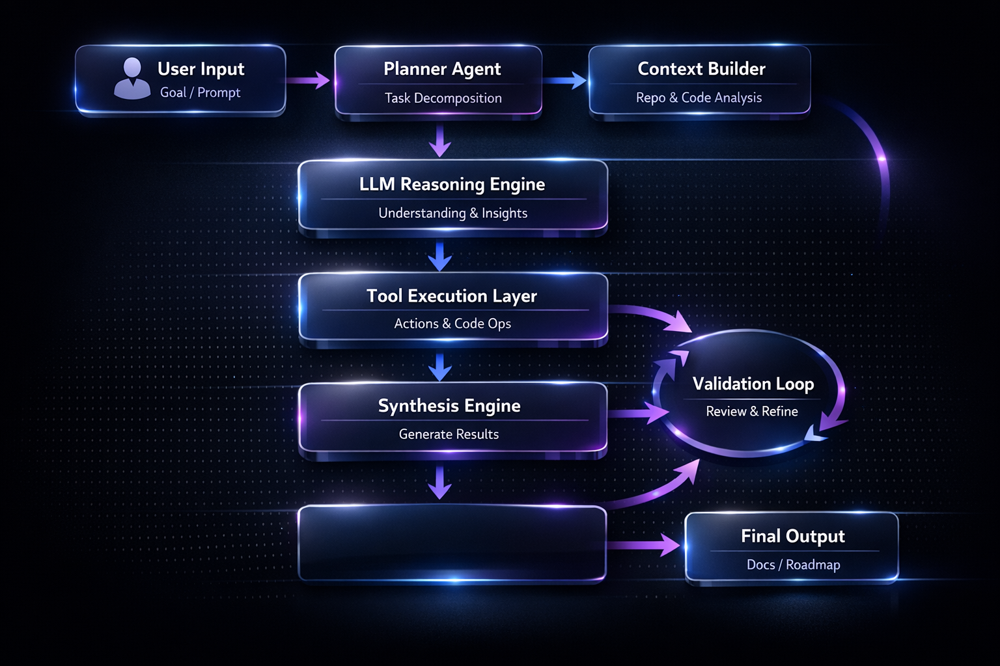
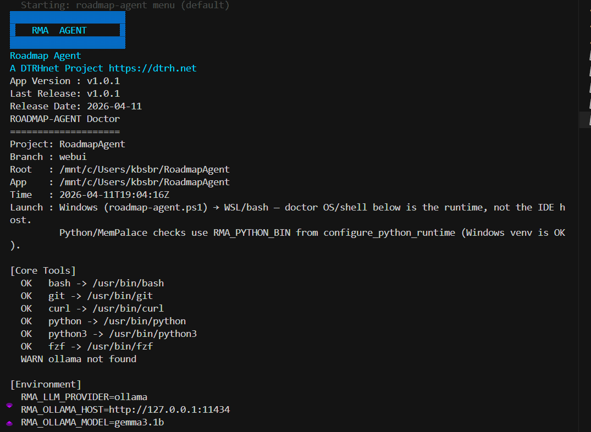

<div align="center">


# ROADMAP-AGENT

**Plan and ship in small steps** — Markdown contracts combined with local or remote **LLMs**, context window handling with tools like  **MemPalace**, optional **MCP** for advanced developers, optional **Web UI** for handling everything from a visual perspective, and **cross-platform** tooling with **Docker** images on **GHCR** and support built in from the start to handle Windows, Linux, MacOS, Docker images, WSL subsystem.

[](CHANGELOG.md)
[](https://github.com/DTRHnet/Roadmap-Agent/actions/workflows/ci.yml)
[](README.md#deployment-guide)
[](README.md#runtime-model)
[](docs/QUICKSTART.md)
[](docs/ENVIRONMENT-VARIABLES.md)

<br/>

**[How the stack fits](#how-the-components-fit-together)** · **[Cross-platform & Docker](#cross-platform-and-docker)** · **[Configuration](#configuration-and-customization)** · **[RUN scripts](#run-scripts-beyond-the-cli)** · **[Web UI](#companion-web-ui)** · **[Documentation](#documentation-library)** · **[License](#license-and-attribution)** · **[Changelog](CHANGELOG.md)**

</div>

---

## Notice

This project is in **beta**. The core workflow runs with **plain Markdown** and a **terminal**; everything else is **optional**. Use at your own discretion.

I advise you spend some time reading the docs/* folder and checking out the examples. In time, I plan to have this more user friendly, but at the moment - even with a lot of graceful scripts handling installation, virtual environments, multiple operating systems, etc. It's still far from a tool suitable for novices. 


---

## Table of contents

| Section | Description |
|---------|-------------|
| [How the components fit together](#how-the-components-fit-together) | CORE, LLM, scripts, MemPalace, Web UI, MCP — mix and match |
| [Cross-platform and Docker](#cross-platform-and-docker) | Windows, Linux, macOS, GHCR images |
| [Configuration and customization](#configuration-and-customization) | `.env` whitelist and **[`docs/ENVIRONMENT-VARIABLES.md`](docs/ENVIRONMENT-VARIABLES.md)** |
| [RUN scripts (beyond the CLI)](#run-scripts-beyond-the-cli) | `RUN.sh`, `RUN.ps1`, `rma_cli.*`, handoff menus |
| [Companion Web UI](#companion-web-ui) | Local FastAPI + React for `.env`, doctor, presets |
| [Terminal hub & visuals](#terminal-hub--visuals) | Interactive menus, diagrams |
| [Documentation library](#documentation-library) | Handbooks, examples, architecture |
| [License and attribution](#license-and-attribution) | Apache 2.0, `NOTICE` |
| [Changelog](#changelog) | Release history |

---

## How the components fit together

You **do not** need every subsystem. The **minimum** is the **CORE** CLI: **`roadmap-agent`** / **`rma`**, a project **`.rma/`** tree, and (for LLM-backed commands) a configured **provider**. Everything else **adds** capability:

| Component | What it does | If you skip it |
|-----------|----------------|----------------|
| **CORE** (`scripts/unix/roadmap-agent.sh`, Windows bridge, **`launchers/`**) | Hub, **`init`**, **`plan`**, **`analyze`**, **`execute-one`**, **`doctor`**, persistence, release helpers | N/A — this is the product shell. |
| **LLM** (Ollama, OpenAI-compatible, Claude via **`RMA_*`**) | Drafts **`plan.md`**, **`analyze-init`** proposals, optional **`analyze`** synthesis, **`agent`** steps | Use heuristics / templates where implemented; no cloud required if you use **Ollama** locally. |
| **Scripts** (MemPalace setup, **`setup-venv`**, installers) | Bootstrap **`.rma/venv`**, normalize PATH, optional **fzf** | Install Python deps manually; some menu actions stay unavailable until deps exist. |
| **MemPalace** + **ChromaDB** | Indexes your tree for retrieval; **`plan`** can merge **wake-up** text with `.rma` Markdown | **`plan`** still works from **`.rma/*.md`** alone; mining is for richer context. |
| **MCP** (`rma_mcp`) | Exposes **`roadmap://context`** and tools to **Cursor**, **Claude Desktop**, etc. | Use CLI or Web UI only; no IDE integration. |
| **Web UI** (`web/`) | Browser **`.env`** editor (whitelisted keys), **`doctor --json`**, API to run **`rma`** | Configure **`.env`** by hand; no browser. |
| **Sysinfo** | Read-only workspace audit; **`rma_sysinfo`** from MCP | Omit diagnostics that depend on it. |
| **Docker** | Reproducible CLI/runtime in a container | Install from source or persistence on the host instead. |

**Typical flows:**

- **Solo dev, terminal-only:** CORE + LLM + **`.rma/`** files → **`plan`** → **`execute-one`** loop.
- **IDE-assisted:** add **MCP** so the model can read context and invoke **`rma_plan`** / **`rma_analyze`** without leaving the editor.
- **Team onboarding:** optional **Web UI** so non-terminal users can tune **`RMA_*`** and run **`doctor`** safely on loopback.

**Diagram — mining vs roadmap loop** (complementary tracks):


---

## Cross-platform and Docker

| Platform | Entry | Notes |
|----------|--------|--------|
| **Windows** | **`launchers/rma.ps1`**, **`roadmap-agent.cmd`**, persistence under **`%LOCALAPPDATA%\Roadmap-Agent`** | PowerShell installs **persistence** without WSL; **`rma`** may still call **Git Bash** / WSL for the bash runtime. |
| **Linux / macOS** | **`launchers/roadmap-agent`**, **`persistence --user`** → **`~/.local/bin`** | System install optional (**`/usr/local`**). See **[README — Persistence by OS](README.md#persistence-on-path-by-operating-system)**. |
| **Docker** | **`Dockerfile`**, **`docker/Dockerfile.web`**, **GHCR** | CI publishes **`ghcr.io/.../roadmap-agent`** and **`roadmap-agent-web`** (rolling **`edge`**, versioned on **`v*`** tags). See **[`docs/RELEASING.md`](docs/RELEASING.md)** and **[README — Quick start / Docker](README.md#docker-prebuilt-images-on-ghcr)**. |

Prebuilt images let you run the same toolkit in **CI**, **servers**, or **devcontainers** without a global PATH install — mount your repo at **`/workspace`** and use the **entrypoint** (see **`docker-compose.yml`** and **`web/README.md`**).

---

## Full setup workflow

1. **Clone** this repository and open a terminal at the repo root (or use your project’s root when using ROADMAP-AGENT against another codebase).
2. **Python + MemPalace (required for `mine`; recommended for `plan` wake-up context)** — creates `.rma/venv` (or `RMA_PYTHON_VENV_DIR`) and installs **`mempalace`** + **`chromadb`** plus health-check dependencies. Configure an **LLM** for **`plan`** (Ollama is typical):
   - Windows: `.\scripts\windows\setup-local-models-mempalace.ps1`
   - Linux/macOS: `./scripts/unix/setup-local-models-mempalace.sh`
3. **Environment variables** — copy `.env.example` to `.env` at the **project root** you work in (the app or repo under analysis). Edit `RMA_*` values and any API keys. The runtime reads `.env` from the detected project root when present.
4. **Diagnostics** — `.\launchers\rma.ps1 doctor` (Windows) or `./launchers/roadmap-agent doctor` (Unix) to verify `git`, `bash`, Python venv, LLM providers, and persistence sync.
5. **Roadmap memory** — `init` once, then use the interactive menu or individual commands as needed.

### Persistence on PATH (by operating system)

Install **persistence** when you want **`roadmap-agent`** / **`rma`** on your **PATH** so you can **`cd`** to any project and run **`init`**, **`plan`**, etc. Your app’s **`.rma/`** stays in **that project’s directory**. See **[`docs/MANUAL.md`](docs/MANUAL.md#persistence-global-commands)**.

#### Windows

| | |
|--|--|
| **Install** | Native **PowerShell** (WSL not required for install): **`.\launchers\setup-rma.ps1 -Scope User`**, or **`rma persistence --user`**. |
| **Paths** | **`%LOCALAPPDATA%\Roadmap-Agent`** (user) or **`%ProgramFiles%\Roadmap-Agent`** (machine); **`…\Roadmap-Agent\bin`** on **PATH**. |
| **After install** | **`.\scripts\windows\refresh-rma-path.ps1`** or a new terminal. **`rma persistence --help`** for scopes. |
| **Check** | **`.\launchers\setup-rma.ps1 -CheckOnly -Scope Auto`** or **`rma persistence-check`**. |

#### Linux

| | |
|--|--|
| **User (no sudo)** | **`./launchers/roadmap-agent persistence --user`** → **`~/.local/lib/roadmap-agent`**, **`~/.local/bin`**. |
| **System** | **`sudo ./launchers/roadmap-agent persistence`** → **`/usr/local/...`**. |
| **Check** | **`roadmap-agent persistence-check`**. Open a **new** shell or **`source`** your rc after PATH snippets. |

#### macOS

Same as **Linux** (`~/.local/...` user install). Ensure **`~/.local/bin`** is on your **PATH** in Terminal.

#### Docker

Use prebuilt **GHCR** images or **`docker run -v "$PWD:/workspace"`** — no host **PATH** persistence; see **[Deployment guide — Docker](#c-docker)**.

---

## Configuration and customization

ROADMAP-AGENT is **highly tunable** through environment variables. Only **whitelisted** keys are read from the project **`.env`** by the CLI (and exposed in the Web UI editor); the full matrix — LLM, MemPalace, plan/analyze behavior, **Web**, **MCP**, **agent** — is maintained as a dedicated reference:

**[`docs/ENVIRONMENT-VARIABLES.md`](docs/ENVIRONMENT-VARIABLES.md)** — tables of every supported variable, grouped by subsystem.

Start from **[`.env.example`](.env.example)** (commented catalog); keep real secrets out of git (**`.gitignore`** covers **`.env`**).

---

## RUN scripts (beyond the CLI)

### RUN.sh / RUN.ps1

Root **`RUN.sh`** (Unix) and **`RUN.ps1`** (Windows) go further than a bare **`roadmap-agent`** invocation:

- Bootstrap **Python venv** / dependencies when needed.
- Set **`ROADMAP_AGENT_APP_ROOT`** / **`ROADMAP_AGENT_PROJECT_ROOT`** correctly (important on Windows so the bash bridge resolves the toolkit, not a temp copy).
- Optionally open an **interactive handoff menu** (multi-terminal **Web API**, **Vite**, **hub**) when run **without** arguments — see **[README — RUN.sh / RUN.ps1](README.md#runsh--runps1)** behavior.

**`rma_cli.sh`** / **`rma_cli.ps1`** / **`rma_cli.cmd`** print a **status dashboard** (Ollama, web port, MCP **`runtime.json`**, **`rma_agent`** import) and then delegate to **`RUN.*`**.

Use these when you want **one entrypoint** for a dev session instead of chaining **`launchers/`** commands manually.

---

## Companion Web UI

The optional **local** stack (**FastAPI** + **Vite/React**) helps teams who prefer a **browser** for:

- Editing **whitelisted** **`.env`** keys (same names as **[`docs/ENVIRONMENT-VARIABLES.md`](docs/ENVIRONMENT-VARIABLES.md)**).
- Running **`doctor --json`**, **Ollama** probes, and **roadmap presets** (status, plan, analyze, MCP start, etc.) against the project root you select.

Bind defaults stay on **loopback**; set **`RMA_WEB_ADMIN_TOKEN`** for mutating routes. Full setup: **[`web/README.md`](web/README.md)**.



---

## Terminal hub & visuals

The **interactive hub** ( **`fzf`** when available ) drives roadmap, MemPalace, environment, and Web/MCP categories without memorizing every flag:



High-level **flowchart** (planner → tools → output) for the modular agent:



Additional assets: **[`img/roadmap-agent-ui-placeholder.svg`](img/roadmap-agent-ui-placeholder.svg)**, **[`img/doctor.png`](img/doctor.png)** (doctor / health metaphor), **[`img/roadmap-agent-github-banner.png`](img/roadmap-agent-github-banner.png)**.

---

## Documentation library

| Topic | Document |
|-------|----------|
| **This file** (overview, quick orientation) | **[`README.md`](README.md)** (you are here) |
| **Extended manual** (full TOC, commands, deployment, env tables) | **[`README2.md`](README2.md)** |
| **Environment variables (tables)** | **[`docs/ENVIRONMENT-VARIABLES.md`](docs/ENVIRONMENT-VARIABLES.md)** |
| **`.env` template (prose)** | **[`.env.example`](.env.example)** |
| **Quick start by OS** | **[`docs/QUICKSTART.md`](docs/QUICKSTART.md)** |
| **Getting started** | **[`docs/GETTING-STARTED.md`](docs/GETTING-STARTED.md)** |
| **Operator manual** | **[`docs/MANUAL.md`](docs/MANUAL.md)** |
| **Roadmap workflow** | **[`docs/ROADMAP-WORKFLOW.md`](docs/ROADMAP-WORKFLOW.md)** |
| **Menu reference** | **[`docs/MENU-REFERENCE.md`](docs/MENU-REFERENCE.md)** |
| **Architecture** | **[`docs/ARCHITECTURE.md`](docs/ARCHITECTURE.md)** |
| **MCP server** | **[`docs/MCP-SERVER.md`](docs/MCP-SERVER.md)** |
| **Agent (`rma_agent`)** | **[`docs/agent/usage.md`](docs/agent/usage.md)**, **[`docs/agent/architecture.md`](docs/agent/architecture.md)** |
| **Web UI** | **[`web/README.md`](web/README.md)** |
| **Examples hub** | **[`docs/examples/README.md`](docs/examples/README.md)** |
| **Releasing & Docker publish** | **[`docs/RELEASING.md`](docs/RELEASING.md)** |
| **Testing / CI** | **[`docs/TESTING.md`](docs/TESTING.md)** |
| **Troubleshooting** | **[`docs/TROUBLESHOOTING.md`](docs/TROUBLESHOOTING.md)** |
| **Man page (source)** | **[`docs/man/roadmap-agent.1`](docs/man/roadmap-agent.1)** |

---


---

## Runtime model

### 1) Launchers

- **User-facing CLI entrypoints** live under **`launchers/`** (`roadmap-agent`, `rma`, `*.cmd`, `*.ps1`, `rma.sh`). The repo root keeps only **`RUN.*`** for bootstrap.
- On Windows, launchers call `scripts/windows/roadmap-agent.ps1`.
- On Linux/macOS, launchers call `scripts/unix/roadmap-agent.sh`.
- Current Windows runtime is a Defender-safe bridge: it forwards core CLI execution to the Unix runtime through `bash` (WSL/Git Bash), and keeps persistence install handling local on Windows.

### 2) Core metadata and state (`.rma/`)

`ROADMAP-AGENT` stores project context and generated planning state in `.rma/` at the project root.

Required context files:

- `.rma/description.md`
- `.rma/ui.md`
- `.rma/stack.md`
- `.rma/other.md`

If any required files are missing, the CLI warns and suggests running `roadmap-agent init`.

Generated files/directories include:

- `.rma/*.example.md`
- `.rma/roadmaps/plan.md`
- `.rma/roadmaps/tasks.md`
- `.rma/roadmaps/run.md`
- `.rma/state/`
- `.rma/logs/`
- `.rma/mempalace/`

### 3) Interactive menu

- Uses `fzf` for all interactive selections but gracefully handles scenarios in which fzf cant be downloaded or is not installed
- Includes roadmap and persistence-check entries in the same UI.
- **Easily manage everything from the TUI**

<figure align="center">
  
  <figcaption align="center"><sub><i>Terminal hub — run <code>RUN.ps1</code>, <code>RUN.sh</code>, or <code>RUN.cmd</code> at the repo root, or <code>launchers/rma</code> / <code>launchers/roadmap-agent</code> with no arguments.</i></sub></figcaption>
</figure>

### 4) Doctor (diagnostics)

**`roadmap-agent doctor`** (or **`rma doctor`**) prints a structured health report for the **current project and shell**: core tools (**`bash`**, **`git`**, **`python`**, **`fzf`**, **Ollama**, …), **environment variables** that affect LLM and MemPalace behavior, **Python venv / MemPalace** import checks, and **persistence** / install sync hints. It is the fastest way to see whether a failure is a **missing binary**, a **wrong venv layout** (Windows vs WSL vs Git Bash), an **unreachable model**, or a **stale global install**.

On Windows, when the **PowerShell bridge** hands off to **`bash`**, the banner can note that **OS/shell lines refer to the runtime session**, not necessarily the IDE host—so you interpret **PATH**, **Python**, and **MemPalace** lines in context. **`doctor --json`** emits the same picture as **JSON** for scripts and the **companion web UI**.

<figure align="center">
  
  <figcaption align="center"><sub><i>Example <code>doctor</code> output — use it after setup or when something breaks to narrow down environment and tooling issues.</i></sub></figcaption>
</figure>

### 5) Optional companion web UI

<figure align="center">
  
  <figcaption align="center"><sub><i>Local web UI — guided <code>.env</code> editing, diagnostics, and model checks (optional companion to the terminal hub).</i></sub></figcaption>
</figure>

A **local** FastAPI + React app under [`web/`](web/) can edit the same whitelisted keys as `load_rma_env_file()` in `.env`, run **`rma doctor --json`**, read **`rma tools --json`**, probe Ollama / OpenAI-compatible endpoints, and stream **`ollama pull`**. The backend invokes **`scripts/windows/roadmap-agent.ps1`** or **`scripts/unix/roadmap-agent.sh`** under **`RMA_WEB_APP_ROOT`** (the toolkit checkout), with **`ROADMAP_AGENT_PROJECT_ROOT`** set to the app directory you pick in the UI — same bridge behavior as the CLI, not a separate SaaS.

I intend on expanding on the webui a lot. But at the moment, it's functional.

**SPA behavior**

- **Guided** — keys grouped by topic with short section blurbs and **per-field hints** (provider-specific blocks for Ollama, OpenAI-compatible, Claude).
- **Advanced** — search/filter across every manifest env key; **bulk `KEY=value`** textarea to paste many assignments at once (**load from form**, **apply to form**, **save**). Bulk updates only keys you list; other lines in `.env` stay as on disk.
- **Footer** — opens **MANUAL**, **QUICKSTART**, **web README**, **TROUBLESHOOTING**, **ARCHITECTURE**, **MENU-REFERENCE**, and **`.env.example`** on GitHub (upstream `main` by default). For a fork or custom docs host, set **`VITE_DOCS_BASE`** when building the frontend (see [`web/README.md`](web/README.md)).

**Fast path**

1. **From the hub (menu):** open **`roadmap-agent`** / **`rma`** with no args → choose **Web & MCP** → **Start API** (creates **`.rma/venv`** if missing, **`pip install -r requirements-web.txt`**, then **uvicorn** on **:8765**) or **Start frontend** (**`npm install`** and **Vite** on **:5173**). Use two terminals if you want both. See **`docs/MENU-REFERENCE.md`** for the full category map. 
2. **CLI:** **`roadmap-agent web-api`** (alias **`web-backend`**) and **`roadmap-agent web-frontend`** — same behavior as VII / VIII.
3. **Scripts:** `web/run-backend.ps1` (Windows) or `web/run-backend.sh` (Unix) — same API port; they install **`requirements-web.txt`** with the current **`python`** on `PATH` (hub/CLI prefer the **project venv** under **`RMA_PYTHON_VENV_DIR`**).
4. **UI (dev) without hub:** `cd web/frontend && npm install && npm run dev` — open **http://127.0.0.1:5173**, set **Project root** to your repo.
5. **Optional:** set **`RMA_WEB_ADMIN_TOKEN`** in the shell environment before starting the API so mutating routes require **`X-RMA-Web-Token`**.

**Other modes:** build the SPA (`npm run build` in `web/frontend`) and serve it from the same port as the API; or use **`docker compose up --build`** (see [`web/README.md`](web/README.md) for pre-building `dist/` and Windows vs Compose notes).

Full reference: **[`web/README.md`](web/README.md)**, **[`docs/MANUAL.md`](docs/MANUAL.md)** (*Companion web UI*), **`docker-compose.yml`**, **`docker/Dockerfile.web`**.

---

---

## Quick start

```bash
# from clone root (launchers/ holds CLI shims; root has only RUN.*)
./launchers/roadmap-agent init
./launchers/roadmap-agent
```

Windows PowerShell:

```powershell
.\launchers\rma.ps1 init
.\launchers\rma.ps1
```

### Docker (prebuilt images on GHCR)

CI publishes containers to **GitHub Container Registry** under the **`dtrhnet`** org (lowercase). **Rolling / manual** workflow runs use the **`edge`** tag:

```bash
docker pull ghcr.io/dtrhnet/roadmap-agent:edge
docker pull ghcr.io/dtrhnet/roadmap-agent-web:edge
```

**Versioned releases:** when maintainers push a **`v*`** git tag, the same workflow also tags images as **`:latest`**, **`:v…`**, and the bare semver (see **[`docs/RELEASING.md`](docs/RELEASING.md)**). A **`:stable`** tag is planned for a future release cadence; until then, pin **`:latest`** from a tagged release or use an explicit version tag from the registry.

Example CLI container (mount your project at **`/workspace`**):

```bash
docker run --rm -it -v "$PWD:/workspace" ghcr.io/dtrhnet/roadmap-agent:edge
```

The **`-web`** image is the FastAPI app plus built SPA; ports and compose are covered in **[`web/README.md`](web/README.md)** and **`docker-compose.yml`**.

**More detail:** **[`docs/QUICKSTART.md`](docs/QUICKSTART.md)** (by OS), **[`web/README.md`](web/README.md)** (optional web UI), **[`docs/MANUAL.md`](docs/MANUAL.md)** (full reference), **[`docs/ROADMAP-WORKFLOW.md`](docs/ROADMAP-WORKFLOW.md)** (how to run the roadmap loop), **[`img/flowchart.png`](img/flowchart.png)** (mining vs roadmap diagram), **[`docs/examples/rma-context-samples/`](docs/examples/rma-context-samples/)** (sample `.rma` Markdown), **[`docs/examples/END-TO-END-LIST-SHARING-APP.md`](docs/examples/END-TO-END-LIST-SHARING-APP.md)** (full product example), **[`docs/examples/MOCK-WORKFLOW-SESSION.md`](docs/examples/MOCK-WORKFLOW-SESSION.md)** (sample transcript), **[`CHANGELOG.md`](CHANGELOG.md)** (releases).

---

---

## Deployment guide

Use the toolkit **per repo**, **globally on PATH**, or **in Docker**, depending on your team.

### A) Project-local (recommended)

Use repository scripts directly, keeping everything scoped to the current project.

### Windows

```powershell
git clone https://github.com/DTRHnet/Roadmap-Agent.git
cd RoadmapAgent
.\launchers\rma.ps1 init
.\launchers\rma.ps1
```

If `bash` is unavailable, install WSL or Git Bash to enable the full menu workflow.

### Linux/macOS

```bash
git clone https://github.com/DTRHnet/Roadmap-Agent.git
cd RoadmapAgent
chmod +x launchers/roadmap-agent launchers/rma scripts/unix/roadmap-agent.sh
./launchers/roadmap-agent init
./launchers/roadmap-agent
```

Best when you want isolated behavior per repository.

### B) Global / persistence (PATH)

See **[Persistence on PATH (by operating system)](#persistence-on-path-by-operating-system)** under [Full setup workflow](#full-setup-workflow). Re-run the installer after **`git pull`** so mirrored copies stay in sync; use **`persistence-check`** / **`setup-rma.ps1 -CheckOnly`** to verify.

### C) Docker

Build:

```bash
docker build -t roadmap-agent .
```

Run:

```bash
docker run --rm -it -v "$PWD:/workspace" roadmap-agent
```

Notes:

- Mount your project into `/workspace`.
- Container entrypoint routes into the Unix runtime.

**Prebuilt images (CI):** Pushing a git tag **`v*`** runs **[`.github/workflows/docker-publish.yml`](.github/workflows/docker-publish.yml)** and publishes **`ghcr.io/<github-owner-lowercase>/roadmap-agent`** and **`.../roadmap-agent-web`** (with **`:latest`** and version tags). Details: **[`docs/RELEASING.md`](docs/RELEASING.md)** (*Docker image → CI publish*).

---

## License and attribution

ROADMAP-AGENT is licensed under the **Apache License, Version 2.0**. See **[`LICENSE`](LICENSE)** for full terms and **[`NOTICE`](NOTICE)** for third-party attribution (MemPalace, ChromaDB, MCP, Ollama ecosystem, FastAPI/React, etc.).

---

## Changelog

Release history, semantic-versioning intent, and migration notes: **[`CHANGELOG.md`](CHANGELOG.md)**.

---

<p align="center"><strong>A DTRH.net Project (2026) &lt;admin[at]dtrh[dot]net&gt; — <a href="https://dtrh.net">DTRH.net</a></strong></p>
