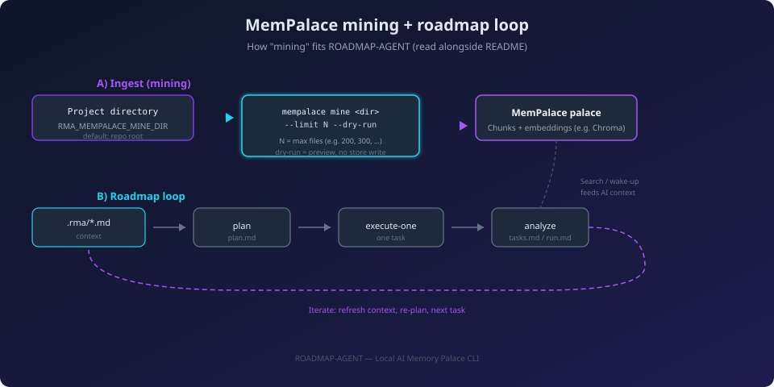
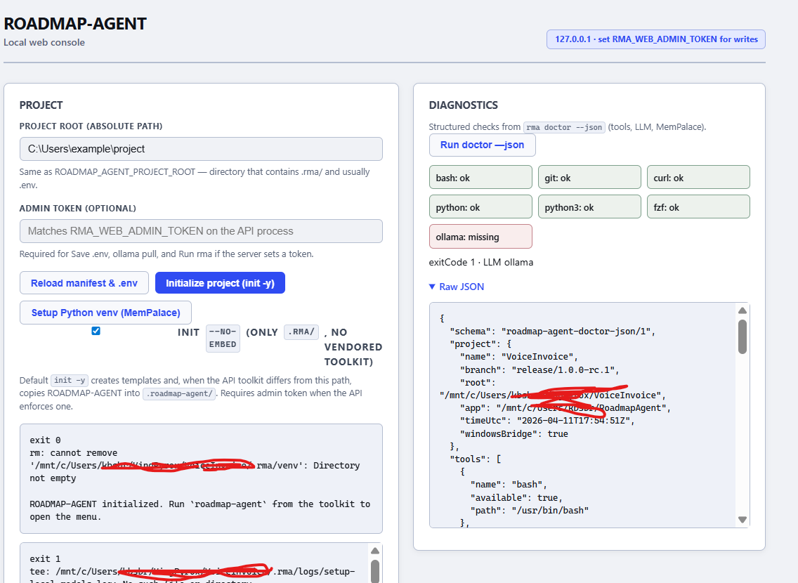
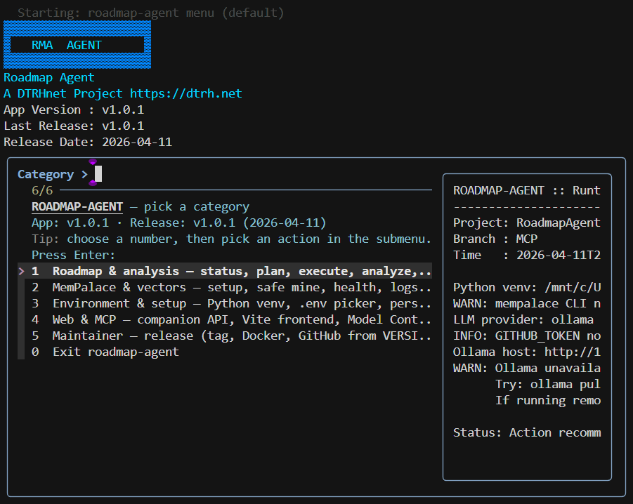
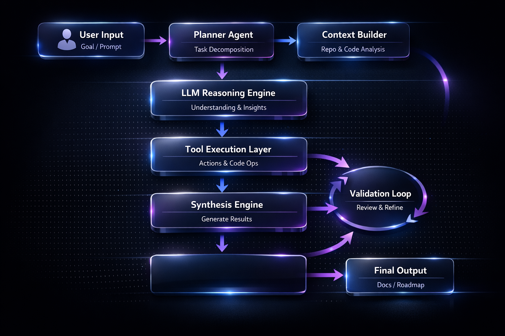

# ROADMAP-AGENT

**Plan and ship in small steps** — Markdown contracts in **`.rma/`**, local or remote **LLMs**, optional **MemPalace**, optional **MCP** for IDEs, optional **Web UI**, and **cross-platform** tooling with **Docker** images on **GHCR**.

 

**[How the stack fits](#how-the-components-fit-together)** · **[Cross-platform & Docker](#cross-platform-and-docker)** · **[Configuration](#configuration-and-customization)** · **[RUN scripts](#run-scripts-beyond-the-cli)** · **[Web UI](#companion-web-ui)** · **[Documentation](#documentation-library)** · **[License](#license-and-attribution)** · **[Changelog](CHANGELOG.md)**

---

## Notice

This project is in **beta**. The core workflow runs with **plain Markdown** and a **terminal**; everything else is **optional**. Use at your own discretion.

---

## Table of contents

| Section | Description |
|---------|-------------|
| [How the components fit together](#how-the-components-fit-together) | CORE, LLM, scripts, MemPalace, Web UI, MCP — mix and match |
| [Cross-platform and Docker](#cross-platform-and-docker) | Windows, Linux, macOS, GHCR images |
| [Configuration and customization](#configuration-and-customization) | `.env` whitelist and **[`docs/ENVIRONMENT-VARIABLES.md`](docs/ENVIRONMENT-VARIABLES.md)** |
| [RUN scripts (beyond the CLI)](#run-scripts-beyond-the-cli) | `RUN.sh`, `RUN.ps1`, `rma_cli.*`, handoff menus |
| [Companion Web UI](#companion-web-ui) | Local FastAPI + React for `.env`, doctor, presets |
| [Terminal hub & visuals](#terminal-hub--visuals) | Interactive menus, diagrams |
| [Documentation library](#documentation-library) | Handbooks, examples, architecture |
| [License and attribution](#license-and-attribution) | Apache 2.0, `NOTICE` |
| [Changelog](#changelog) | Release history |

---

## How the components fit together

You **do not** need every subsystem. The **minimum** is the **CORE** CLI: **`roadmap-agent`** / **`rma`**, a project **`.rma/`** tree, and (for LLM-backed commands) a configured **provider**. Everything else **adds** capability:

| Component | What it does | If you skip it |
|-----------|----------------|----------------|
| **CORE** (`scripts/unix/roadmap-agent.sh`, Windows bridge, **`launchers/`**) | Hub, **`init`**, **`plan`**, **`analyze`**, **`execute-one`**, **`doctor`**, persistence, release helpers | N/A — this is the product shell. |
| **LLM** (Ollama, OpenAI-compatible, Claude via **`RMA_*`**) | Drafts **`plan.md`**, **`analyze-init`** proposals, optional **`analyze`** synthesis, **`agent`** steps | Use heuristics / templates where implemented; no cloud required if you use **Ollama** locally. |
| **Scripts** (MemPalace setup, **`setup-venv`**, installers) | Bootstrap **`.rma/venv`**, normalize PATH, optional **fzf** | Install Python deps manually; some menu actions stay unavailable until deps exist. |
| **MemPalace** + **ChromaDB** | Indexes your tree for retrieval; **`plan`** can merge **wake-up** text with `.rma` Markdown | **`plan`** still works from **`.rma/*.md`** alone; mining is for richer context. |
| **MCP** (`rma_mcp`) | Exposes **`roadmap://context`** and tools to **Cursor**, **Claude Desktop**, etc. | Use CLI or Web UI only; no IDE integration. |
| **Web UI** (`web/`) | Browser **`.env`** editor (whitelisted keys), **`doctor --json`**, API to run **`rma`** | Configure **`.env`** by hand; no browser. |
| **Sysinfo** | Read-only workspace audit; **`rma_sysinfo`** from MCP | Omit diagnostics that depend on it. |
| **Docker** | Reproducible CLI/runtime in a container | Install from source or persistence on the host instead. |

**Typical flows:**

- **Solo dev, terminal-only:** CORE + LLM + **`.rma/`** files → **`plan`** → **`execute-one`** loop.
- **IDE-assisted:** add **MCP** so the model can read context and invoke **`rma_plan`** / **`rma_analyze`** without leaving the editor.
- **Team onboarding:** optional **Web UI** so non-terminal users can tune **`RMA_*`** and run **`doctor`** safely on loopback.

**Diagram — mining vs roadmap loop** (complementary tracks):

---

## Cross-platform and Docker

| Platform | Entry | Notes |
|----------|--------|--------|
| **Windows** | **`launchers/rma.ps1`**, **`roadmap-agent.cmd`**, persistence under **`%LOCALAPPDATA%\Roadmap-Agent`** | PowerShell installs **persistence** without WSL; **`rma`** may still call **Git Bash** / WSL for the bash runtime. |
| **Linux / macOS** | **`launchers/roadmap-agent`**, **`persistence --user`** → **`~/.local/bin`** | System install optional (**`/usr/local`**). See **[README — Persistence by OS](README.md#persistence-on-path-by-operating-system)**. |
| **Docker** | **`Dockerfile`**, **`docker/Dockerfile.web`**, **GHCR** | CI publishes **`ghcr.io/.../roadmap-agent`** and **`roadmap-agent-web`** (rolling **`edge`**, versioned on **`v*`** tags). See **[`docs/RELEASING.md`](docs/RELEASING.md)** and **[README — Quick start / Docker](README.md#docker-prebuilt-images-on-ghcr)**. |

Prebuilt images let you run the same toolkit in **CI**, **servers**, or **devcontainers** without a global PATH install — mount your repo at **`/workspace`** and use the **entrypoint** (see **`docker-compose.yml`** and **`web/README.md`**).

---

## Configuration and customization

ROADMAP-AGENT is **highly tunable** through environment variables. Only **whitelisted** keys are read from the project **`.env`** by the CLI (and exposed in the Web UI editor); the full matrix — LLM, MemPalace, plan/analyze behavior, **Web**, **MCP**, **agent** — is maintained as a dedicated reference:

**[`docs/ENVIRONMENT-VARIABLES.md`](docs/ENVIRONMENT-VARIABLES.md)** — tables of every supported variable, grouped by subsystem.

Start from **[`.env.example`](.env.example)** (commented catalog); keep real secrets out of git (**`.gitignore`** covers **`.env`**).

---

## RUN scripts (beyond the CLI)

Root **`RUN.sh`** (Unix) and **`RUN.ps1`** (Windows) go further than a bare **`roadmap-agent`** invocation:

- Bootstrap **Python venv** / dependencies when needed.
- Set **`ROADMAP_AGENT_APP_ROOT`** / **`ROADMAP_AGENT_PROJECT_ROOT`** correctly (important on Windows so the bash bridge resolves the toolkit, not a temp copy).
- Optionally open an **interactive handoff menu** (multi-terminal **Web API**, **Vite**, **hub**) when run **without** arguments — see **[README — RUN.sh / RUN.ps1](README.md#runsh--runps1)** behavior.

**`rma_cli.sh`** / **`rma_cli.ps1`** / **`rma_cli.cmd`** print a **status dashboard** (Ollama, web port, MCP **`runtime.json`**, **`rma_agent`** import) and then delegate to **`RUN.*`**.

Use these when you want **one entrypoint** for a dev session instead of chaining **`launchers/`** commands manually.

---

## Companion Web UI

The optional **local** stack (**FastAPI** + **Vite/React**) helps teams who prefer a **browser** for:

- Editing **whitelisted** **`.env`** keys (same names as **[`docs/ENVIRONMENT-VARIABLES.md`](docs/ENVIRONMENT-VARIABLES.md)**).
- Running **`doctor --json`**, **Ollama** probes, and **roadmap presets** (status, plan, analyze, MCP start, etc.) against the project root you select.

Bind defaults stay on **loopback**; set **`RMA_WEB_ADMIN_TOKEN`** for mutating routes. Full setup: **[`web/README.md`](web/README.md)**.

---

## Terminal hub & visuals

The **interactive hub** ( **`fzf`** when available ) drives roadmap, MemPalace, environment, and Web/MCP categories without memorizing every flag:

High-level **flowchart** (planner → tools → output) for the modular agent:

Additional assets: **[`img/roadmap-agent-ui-placeholder.svg`](img/roadmap-agent-ui-placeholder.svg)**, **[`img/doctor.png`](img/doctor.png)** (doctor / health metaphor), **[`img/roadmap-agent-github-banner.png`](img/roadmap-agent-github-banner.png)**.

---

## Documentation library

| Topic | Document |
|-------|----------|
| **Primary README** (full TOC, commands, deployment) | **[`README.md`](README.md)** |
| **Environment variables (tables)** | **[`docs/ENVIRONMENT-VARIABLES.md`](docs/ENVIRONMENT-VARIABLES.md)** |
| **`.env` template (prose)** | **[`.env.example`](.env.example)** |
| **Quick start by OS** | **[`docs/QUICKSTART.md`](docs/QUICKSTART.md)** |
| **Getting started** | **[`docs/GETTING-STARTED.md`](docs/GETTING-STARTED.md)** |
| **Operator manual** | **[`docs/MANUAL.md`](docs/MANUAL.md)** |
| **Roadmap workflow** | **[`docs/ROADMAP-WORKFLOW.md`](docs/ROADMAP-WORKFLOW.md)** |
| **Menu reference** | **[`docs/MENU-REFERENCE.md`](docs/MENU-REFERENCE.md)** |
| **Architecture** | **[`docs/ARCHITECTURE.md`](docs/ARCHITECTURE.md)** |
| **MCP server** | **[`docs/MCP-SERVER.md`](docs/MCP-SERVER.md)** |
| **Agent (`rma_agent`)** | **[`docs/agent/usage.md`](docs/agent/usage.md)**, **[`docs/agent/architecture.md`](docs/agent/architecture.md)** |
| **Web UI** | **[`web/README.md`](web/README.md)** |
| **Examples hub** | **[`docs/examples/README.md`](docs/examples/README.md)** |
| **Releasing & Docker publish** | **[`docs/RELEASING.md`](docs/RELEASING.md)** |
| **Testing / CI** | **[`docs/TESTING.md`](docs/TESTING.md)** |
| **Troubleshooting** | **[`docs/TROUBLESHOOTING.md`](docs/TROUBLESHOOTING.md)** |
| **Man page (source)** | **[`docs/man/roadmap-agent.1`](docs/man/roadmap-agent.1)** |

---

## License and attribution

ROADMAP-AGENT is licensed under the **Apache License, Version 2.0**. See **[`LICENSE`](LICENSE)** for full terms and **[`NOTICE`](NOTICE)** for third-party attribution (MemPalace, ChromaDB, MCP, Ollama ecosystem, FastAPI/React, etc.).

---

## Changelog

Release history, semantic-versioning intent, and migration notes: **[`CHANGELOG.md`](CHANGELOG.md)**.

---

<strong>A DTRH.net Project (2026) &lt;admin[at]dtrh[dot]net&gt; — <a href="https://dtrh.net">DTRH.net</a></strong>

