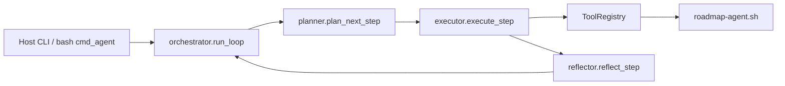

# Modular terminal agent (`rma_agent`) — architecture

The repository’s primary runtime remains **`scripts/unix/roadmap-agent.sh`** (and the Windows bridge). The **`rma_agent`** package is an optional **Python orchestration kernel** for the **`roadmap-agent agent`** command: structured planning, typed tool dispatch, reflection, and memory hooks, while **mutating behavior** for `plan`, `analyze`, `execute-one`, etc. still comes from **bash** via subprocess (same idea as **`rma_mcp`**).

## Flow

- **Planner** — one LLM call returning a validated **`AgentStep`** (Pydantic).
- **Executor** — calls **`ToolRegistry.execute`** only (no ad-hoc string dispatch).
- **Reflector** — second LLM call (**`Critique`**) unless **`RMA_AGENT_SKIP_REFLECT=1`**. Failed critiques trigger **bounded replans** within the same outer step (see **`RMA_AGENT_REFLECT_RETRIES`**).
- **Tools** — **`rma_agent.tools.roadmap_tools`** runs **`bash`** + **`scripts/unix/roadmap-agent.sh`** with **`ROADMAP_AGENT_PROJECT_ROOT`** and **`ROADMAP_AGENT_APP_ROOT`** set.

## State and logs

| Location | Purpose |
|----------|---------|
| `.rma/logs/agent.log` | Same append-only log as the legacy bash loop (compatibility). |
| `.rma/mempalace/agent-history.md` | Step observations (truncated). |
| `.rma/agent_memory/events.jsonl` | Append-only session/tool events. |
| `.rma/agent_memory/trace.jsonl` | Per-step trace (tool + reflect). |

## Relationship to MCP

**`rma_mcp`** is the **IDE protocol** layer (FastMCP). **`rma_agent`** is the **terminal agent** loop. They may both invoke **`roadmap-agent.sh`**; sharing schemas later is possible but not required for v1.

## Legacy bash loop

If **`RMA_AGENT_LEGACY=1`** is set, **`cmd_agent`** uses the original inline bash ReAct loop instead of **`python -m rma_agent`**.
