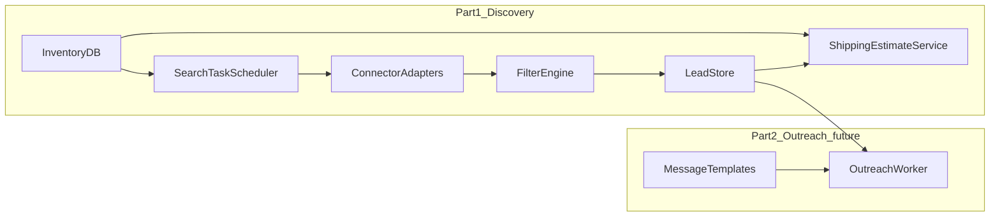

# End-to-end example: autopart leads app with ROADMAP-AGENT (PowerShell)

This walkthrough is **illustrative**. Commands, transcripts, and file excerpts are **fictional** but aligned with how ROADMAP-AGENT is meant to be used on **Windows**: you keep the product in **your app repo**, initialize **`.rma/`**, run **`doctor`**, then loop **`plan` → `execute-one` → `analyze`**, optionally using **MemPalace** so plans and agents stay grounded in your tree. Adjust paths to your machine.

**Product we are pretending to build:** **Autopart Leads** — an app for **parts sellers** with an **inventory database** (SKU, dimensions, weight, part type, stock levels). **Part 1** focuses on **finding leads**: people online who appear to want parts you have on hand, using **search tasks**, **filters** (location, willingness to ship, country include/exclude), and **scheduled triggers** (time of day, intervals, calendar-style runs). Connectors can target **forums** and similar surfaces **where policy allows**; **shipping estimates** combine inventory attributes with **distance** and **carrier or rule-based** pricing. **Part 2** is **autonomous outreach** (messages to leads)—architected here but **not** implemented by ROADMAP-AGENT itself; you ship it as application code behind the same roadmap loop.

**What success looks like:** you **ship working software** iteratively—each cycle refines **`.rma` Markdown**, refreshes **MemPalace** when you use it, and lands **vertical slices** (schema → scheduler stub → one connector interface → filters) via **`execute-one`**. ROADMAP-AGENT **does not** run Facebook Marketplace, cron jobs, or carrier APIs for you; it **plans and tracks** the work honestly.

---

## Legal and operational disclaimer (read this)

- **Third-party terms:** Sites such as **Facebook Marketplace**, **forums**, and **classifieds** have **Terms of Service**, **anti-automation** clauses, and **rate limits**. Automating logins, scraping, or bulk messaging may **violate** those terms or local law. This document **does not** instruct you to bypass protections or ToS.
- **Prefer allowed channels:** **Official APIs**, **partner feeds**, **export files**, **RSS**, or **manual** triage where automation is restricted.
- **Credentials:** Store **cookies**, passwords, and API keys in a **secrets vault** or OS-backed store—not in git, not in plain **`.env`** for production. Rotate credentials; audit access.
- **Outreach (Part 2):** **CAN-SPAM**, **GDPR**, **CASL**, and similar regimes apply to commercial messaging. Use **consent**, **opt-out**, **identity**, and **human review** where required. **ROADMAP-AGENT** does not provide legal advice.
- **Human review:** Treat **lead qualification** and **first contact** as **high-risk** steps; design **dry-run** and **approval queues** before any autonomous send.

---

## 1 — What ROADMAP-AGENT does vs what you build

| Layer | Owned by ROADMAP-AGENT | Owned by your Autopart Leads app |
|-------|------------------------|----------------------------------|
| Product memory in Markdown | **`.rma/description.md`**, **`ui.md`**, **`stack.md`**, **`other.md`** — contract for **`plan`** / agents | You **author** content for inventory, leads, compliance |
| Roadmap files | **`.rma/roadmaps/plan.md`**, **`tasks.md`**, **`run.md`** — generated / updated by **`plan`**, **`analyze`** | You **execute** tasks in your repo |
| CLI / hub | **`init`**, **`doctor`**, **`plan`**, **`analyze`**, **`execute-one`**, **`agent`**, MemPalace **mine** menus | You run commands from **your app root** |
| Inventory DB, lead store, tasks | — | **Your** schema, APIs, workers |
| Schedulers (every N min, time-of-day) | — | **Windows Task Scheduler**, Windows **Service**, or **cron** on a server — **not** built into RMA |
| Social / forum connectors | — | **Your** adapters (HTTP, official SDKs, **policy-compliant** automation) |
| Shipping cost API / rules | — | **Your** integration (carrier APIs, dim weight, geocoding) |
| MCP / Web UI | Optional: **[`MCP-SERVER.md`](../MCP-SERVER.md)**, **[`web/README.md`](../../web/README.md)** | Same toolchain; optional for your team |

---

## 2 — Target architecture (conceptual)



**Triggers:** `SearchTaskScheduler` is **your** code + OS scheduler (e.g. Task Scheduler launches `AutopartLeads.Worker.exe` or `python -m autopart_leads run-tasks` every N minutes). ROADMAP-AGENT only **documents** that design in **`stack.md`** and breaks it into **`tasks.md`** steps.

---

## 3 — Bring ROADMAP-AGENT into your project

You do **not** merge Autopart Leads into the RoadmapAgent repo. Typical patterns on Windows:

### Option A — Global `rma` on PATH

Install persistence (see **[`QUICKSTART.md`](../QUICKSTART.md)** — `.\launchers\setup-rma.ps1 -Scope User`), then work entirely under:

```text
C:\Users\dev\Projects\AutopartLeads
```

### Option B — Vendor toolkit under `tools\`

```text
C:\Users\dev\Projects\AutopartLeads\
  tools\
    Roadmap-Agent\     # clone or submodule
  src\
  ...
```

### Option C — Git submodule

```powershell
cd C:\Users\dev\Projects\AutopartLeads
git submodule add https://github.com/DTRHnet/Roadmap-Agent.git tools/Roadmap-Agent
```

**Expectation:** **`AutopartLeads`** is the **project root** (`.rma/`, `.env`, `git`). You need **bash** (WSL or Git Bash) for the full **`roadmap-agent.sh`** runtime when using **`rma.ps1`**.

---

## 4 — One-time: Python, MemPalace, `.env`

From **`AutopartLeads`**:

```powershell
cd C:\Users\dev\Projects\AutopartLeads
Copy-Item .\tools\Roadmap-Agent\.env.example .env
# Or if ROADMAP-AGENT is only on PATH, copy from your clone:
# Copy-Item C:\path\to\RoadmapAgent\.env.example .env

notepad .env
```

**Alternative bootstrap** (venv + `.env` seed + menu) from a Roadmap-Agent checkout:

```powershell
cd C:\Users\dev\Projects\AutopartLeads
C:\path\to\RoadmapAgent\RUN.ps1 -y doctor
```

Run MemPalace setup:

```powershell
.\tools\Roadmap-Agent\scripts\windows\setup-local-models-mempalace.ps1
```

**Mock output (abbreviated):**

```text
[INFO] Log: C:\Users\dev\Projects\AutopartLeads\.rma\logs\setup-local-models.log
[INFO] Using Python: C:\Users\dev\Projects\AutopartLeads\.rma\venv\Scripts\python.exe
[INFO] Installing/refreshing: mempalace, chromadb
[INFO] Imports verified: mempalace, chromadb
[INFO] Setup finished with 0 errors, 0 warnings.
```

**Example `.env` fragment:**

```env
RMA_LLM_PROVIDER=ollama
RMA_OLLAMA_HOST=http://127.0.0.1:11434
RMA_OLLAMA_MODEL=llama3.1:latest
RMA_MEMPALACE_MINE_DIR=.
```

---

## 5 — `init`: scaffold `.rma/`

```powershell
cd C:\Users\dev\Projects\AutopartLeads
rma init
```

If the toolkit root differs from the project root, you may get **embedded** launchers under **`.\rma.ps1`** / **`.roadmap-agent\`** — see **[`QUICKSTART.md`](../QUICKSTART.md)**.

---

## 6 — Fill `.rma/` for Autopart Leads

These excerpts are **starters**—expand them before the first serious **`plan`**.

### `description.md`

```markdown
# Autopart Leads

B2B/B2C tool for parts sellers with an on-hand inventory database. The system
matches inventory to **demand signals** (posts, listings, forum threads) and
produces **qualified leads** with filters for geography and shipping.

## Part 1 (MVP): Discovery
- Inventory: SKU, description, dimensions, weight, part category, quantity on hand.
- Search tasks: keywords, sources, schedules (interval / time window), per-task filters.
- Filters: radius from warehouse, domestic-only vs international, country allow/block lists.
- Shipping estimate: combine part size/weight, distance, and carrier or heuristic rates.

## Part 2 (later): Outreach
- Template-based messages; audit log; human approval before first send; opt-out support.

## Non-goals (initially)
- Violating third-party ToS or bypassing captcha/login walls.
- Unsupervised bulk messaging without compliance review.
```

### `stack.md`

```markdown
# Stack (proposed)

- Runtime: Windows Server or dev workstation; PowerShell for ops scripts.
- App: .NET 8 + PostgreSQL (or Python + FastAPI + SQLite for a prototype).
- Workers: Windows Service or scheduled Task Scheduler jobs invoking `dotnet run -- run-tasks`.
- Secrets: Windows Credential Manager or Azure Key Vault (not git).
- Geocoding / distance: vendor API (optional).
- Carriers: UPS/FedEx/USPS APIs or table-based heuristics for MVP.
- Connectors: pluggable `ILeadSource` — HTTP + official SDKs first; document ToS per source.
```

### `ui.md`

```markdown
# UI notes

- Inventory grid: edit stock, dimensions, HS/category for shipping.
- Search tasks: CRUD, trigger editor (cron-like expression or “every N minutes”), source picker.
- Lead inbox: score, filters applied, estimated ship cost, link to original post (if allowed).
- Settings: warehouse address, default domestic/international rule, credential vault hooks.
- Part 2: outreach queue, template editor, dry-run preview, send approval.
```

### `other.md`

```markdown
# Constraints

- **Compliance:** Only automate sources where permitted; log retention **90 days** default.
- **PII:** Minimize storage of seller/buyer personal data; encrypt at rest.
- **Shipping:** Estimates are non-binding; show confidence / carrier name in UI.
- **Open:** Which carriers for v1? OAuth vs API keys for forums?
```

---

## 7 — `doctor`

```powershell
cd C:\Users\dev\Projects\AutopartLeads
rma doctor
```

**Mock output:**

```text
Project: AutopartLeads | branch: main
bash: ok | git: ok | python (venv): ...\.rma\venv\Scripts\python.exe
RMA_LLM_PROVIDER=ollama | model=llama3.1:latest
[MemPalace] imports: ok
doctor: complete (exit 0)
```

Fix **WARN** lines before relying on **`plan`**.

---

## 8 — Domain modeling (Part 1) — what `plan` should decompose

When context is rich, **`plan`** should propose tasks similar to:

1. **Schema:** `Part`, `StockLevel`, `Warehouse`, `SearchTask`, `SearchRun`, `Lead`, `LeadSource`, `FilterPolicy`, `ShippingEstimate`.
2. **SearchTask triggers:** persist `NextRunAt`, `IntervalMinutes`, `CronExpression` (if you use NCronTask or similar), `TimeZoneId`.
3. **Filter engine:** evaluate lead location vs warehouse; `ShipsDomesticOnly`, `AllowedCountries`, `BlockedCountries`.
4. **Connector interface:** `FetchCandidatesAsync(task)` returning raw items; **no** scraping logic in ROADMAP-AGENT.
5. **Shipping service:** input part dims + weight + origin/destination + service level → money + breakdown.
6. **Audit:** append-only log for every automated search run (for compliance).

**ROADMAP-AGENT** does not create these tables; **`plan`** / **`execute-one`** help you **track** building them.

---

## 9 — First `plan`

```powershell
rma plan
```

**Mock `plan.md` snippet:**

```markdown
## Current focus
Establish inventory + search task schema; stub scheduler entrypoint; mock lead source.

## Suggested sequence
1. EF Core migrations: Part, Warehouse, SearchTask, Lead (minimal fields).
2. Console command: `run-tasks` — loads due SearchTasks, logs “would run” (dry-run).
3. Windows Task Scheduler XML / doc: run every 15 minutes against dev DB.
4. ILeadSource + FakeForumSource returning synthetic posts for UI tests.
5. FilterPolicy service: country lists + domestic flag unit tests.
6. ShippingEstimate: interface + NaiveTableEstimator for MVP.

## Risks
- ToS changes on external sources; credential rotation; false positives on lead matching
```

Use **`rma plan --no-interactive`** or **`RMA_PLAN_INTERACTIVE=0`** in CI.

---

## 10 — `analyze` / `execute-one` loop

```powershell
rma execute-one
```

**Mock task:** “Add EF Core entities Part, Warehouse, SearchTask, Lead and initial migration.”

After implementing:

```powershell
rma analyze
```

**Expectation:** **`execute-one`** drives **small** steps; **Part 2 outreach** tasks should appear only after **Part 1** lead storage and **approval UX** exist.

---

## 11 — MemPalace **mine** (optional)

When you have source under `src/`:

```powershell
rma
# Hub → MemPalace → safe mine (dry-run)
```

**Why:** Retrieval-aware **`plan`** and IDE agents see **current** C# or Python filenames and DTOs—not stale guesses. Refresh after large refactors.

See **[`roadmap-mining-and-loop.svg`](../../img/roadmap-mining-and-loop.svg)**.

---

## 12 — Part 2 — Autonomous outreach (planning only)

Design goals to capture in **`.rma`** and **`plan.md`**:

- **Channels:** same forums/Marketplace messaging APIs **where allowed**, or email with SPF/DKIM.
- **Idempotency:** do not message the same `LeadId` twice without state machine (`Queued` → `Approved` → `Sent`).
- **Human-in-the-loop:** mandatory preview for first N campaigns; **dry-run** log only.
- **Templates:** variables `{PartSku}`, `{EstimatedShip}`, `{SellerName}`; legal footer with opt-out.

Tasks might read: “Add `OutreachQueue` table”, “Implement `PreviewMessage` API”, “Add `SendApprovedLeads` worker behind flag”.

---

## 13 — Optional IDE integration (MCP)

To let Cursor / Claude read **`roadmap://context`** and run **`rma_plan`** / file tools against Autopart Leads:

- **[`docs/MCP-SERVER.md`](../MCP-SERVER.md)**
- **[`rma_mcp/client-config.example.json`](../../rma_mcp/client-config.example.json)**

Set **`ROADMAP_AGENT_PROJECT_ROOT`** to **`AutopartLeads`**.

---

## 14 — Triggers without a built-in cron

ROADMAP-AGENT **does not** ship a scheduler. Typical Windows patterns:

| Approach | When |
|----------|------|
| **Task Scheduler** | Fire `pwsh -File .\scripts\run-search-tasks.ps1` every N minutes |
| **Windows Service** | Long-running worker with internal timer |
| **External orchestrator** | Azure Functions, Kubernetes CronJob, etc. |

Document the chosen approach in **`stack.md`** so **`plan`** does not assume a nonexistent daemon.

---

## 15 — When something goes wrong

| Symptom | What to check |
|--------|----------------|
| `plan` fails | `rma doctor`, Ollama/model, MemPalace venv |
| Tasks too large | Split in **`tasks.md`**; smaller **`execute-one`** slices |
| “We need cron in RMA” | Out of scope — implement scheduler in app; use RMA to **track** the task |
| Compliance worry | Stop automation; review **`other.md`** with legal counsel |

See **[`TROUBLESHOOTING.md`](../TROUBLESHOOTING.md)**.

---

## 16 — Summary

1. Create **AutopartLeads** repo; add ROADMAP-AGENT via PATH, vendor tree, or submodule.  
2. **`RUN.ps1`** or **`setup-local-models-mempalace.ps1`** + **`.env`**; **`rma doctor`**.  
3. **`rma init`**; author **`.rma/*.md`** for inventory, leads, triggers, compliance, Part 2 outreach.  
4. **`plan` → `execute-one` → `analyze`** until Part 1 exists: **DB + scheduler hook + filters + shipping stub + connector interface**.  
5. **Part 2** as a **separate phase** in the same loop—**approval**, **templates**, **audit** before sends.  
6. Prefer **allowed** integrations; keep secrets out of git; use this doc as a **workflow** template, not a scraping how-to.

For a shorter generic transcript, see **[`MOCK-WORKFLOW-SESSION.md`](MOCK-WORKFLOW-SESSION.md)**. For another full product narrative, see **[`END-TO-END-LIST-SHARING-APP.md`](END-TO-END-LIST-SHARING-APP.md)**.
